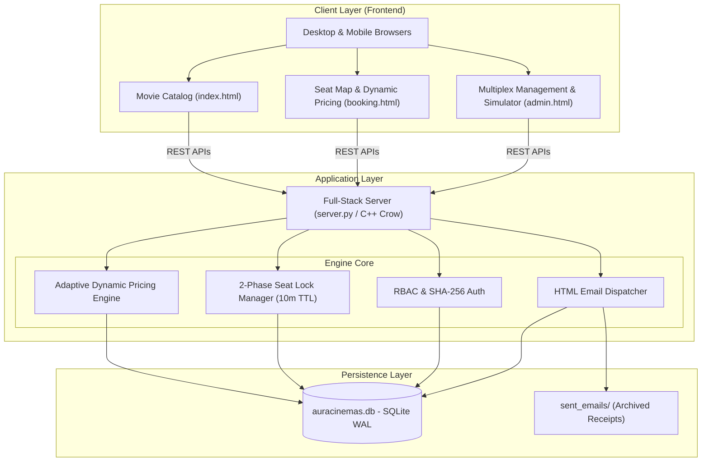

# 🎬 AuraCinemas

[](https://python.org)
[](https://isocpp.org)
[](https://sqlite.org)
[](#)

A high-throughput cinema ticket booking and multiplex management platform engineered with **Adaptive Dynamic Pricing**, **2-Phase Concurrency Seat Locks**, and **Full-Stack Turnkey Execution**.

Developed as an enterprise-grade project for **College SY-Sem1 Discrete Mathematics Course Project (DM CP)** and **Software Engineering / OOP**.

---

## 📑 Table of Contents
- [Key Features](#-key-features)
- [System Architecture](#-system-architecture)
- [Discrete Mathematics & Core Algorithms](#-discrete-mathematics--core-algorithms)
- [Project Directory Structure](#-project-directory-structure)
- [Quick Start Guide](#-quick-start-guide)
- [Core REST API Endpoints](#-core-rest-api-endpoints)
- [Academic & Engineering Documentation](#-academic--engineering-documentation)
- [Default Login Accounts](#-default-login-accounts)

---

## ✨ Key Features

1. **Adaptive Dynamic Pricing Engine**:
   - Location-weighted telemetry scoring across **Theater ($3.0\times$) $\succ$ City ($1.5\times$) $\succ$ National ($0.5\times$)** traffic.
   - Real-time physical auditorium occupancy tracking.
   - **Ethically Bounded Multiplier**: Strictly clamped between **$0.80\times$ (-20% discount floor)** and **$1.80\times$ (+80% surge cap)** to prevent customer exploitation.

2. **High-Concurrency 2-Phase Seat Locking**:
   - 10-minute Time-To-Live (TTL) hold lock preventing race conditions and double-booking.
   - Atomic conditional SQL transitions (`UPDATE ... WHERE status = 'available'`).

3. **Multi-Tier Role-Based Access Control (RBAC)**:
   - Dedicated customer checkout vs. administrative multiplex operations.
   - Administrative isolation preventing test inventory pollution.

4. **Automated Transactional Email Invoicing**:
   - Dispatches formatted HTML tickets with tax breakdown (18% GST + convenience fee).
   - Local disk archiving in `auracinemas/sent_emails/` for offline verification.

5. **Dual-Backend Support**:
   - **Zero-Dependency Python Server** (`server.py`): Runs immediately with Python's standard library.
   - **High-Performance C++20 Backend** (`backend/`): Crow HTTP, CMake, and `std::shared_mutex` readers-writer locking.

---

## 🏗️ System Architecture



---

## 📐 Discrete Mathematics & Core Algorithms

* **Piecewise Multiplier Function**:
  $$M(S) = \begin{cases} 
  1.00 + \left( \frac{S - 50.0}{50.0} \right) \times 0.80 & \text{for } S \ge 50.0 \quad \text{(Surge Slope: } +0.016\text{)} \\
  1.00 - \left( \frac{50.0 - S}{50.0} \right) \times 0.20 & \text{for } S < 50.0 \quad \text{(Discount Slope: } -0.004\text{)}
  \end{cases}$$
* **Set Theory & Partitions**: Equivalence classes partitioning seats into disjoint tiers:
  $$\mathbf{E} = E_{\text{Standard}} \uplus E_{\text{Balcony}} \uplus E_{\text{Premium}} \uplus E_{\text{Recliner}} \uplus E_{\text{VIP}}$$
* **Poset Containment**: Geographic hierarchy tree poset $(C \cup T \cup S \cup H \cup E, \preceq)$.
* **Automata Theory (DFA)**: 5-tuple seat lifecycle automaton $M = (Q, \Sigma, \delta, q_0, F)$ governing state transitions:
  $$\text{Available } \xrightarrow{\text{SelectAndHold}} \text{Locked } \xrightarrow{\text{ConfirmPayment}} \text{Booked}$$
* **Graph Theory & Combinatorics**: 2D planar grid adjacency, contiguous seat path finding, and bipartite matching under Hall's Condition.

---

## 📁 Project Directory Structure

```text
Aura-Cinemas/
├── README.md                      <-- Project homepage & overview
├── .gitignore                     <-- Git ignore rules
├── auracinemas/                   <-- Core application codebase
│   ├── server.py                  <-- Zero-dependency full-stack server
│   ├── auracinemas.db             <-- SQLite pre-populated database
│   ├── database/
│   │   ├── schema.sql             <-- 15 relational tables & triggers
│   │   └── dataset.sql            <-- Mock dataset for Indian multiplexes
│   ├── frontend/
│   │   └── public/
│   │       ├── index.html         <-- Movie catalog homepage
│   │       ├── booking.html       <-- Interactive seat map & live pricing
│   │       ├── admin.html         <-- Admin dashboard & simulation slider
│   │       ├── css/style.css      <-- Dark luxury design system
│   │       └── js/                <-- Frontend controller scripts
│   ├── backend/                   <-- Optional high-performance C++20 backend
│   │   ├── CMakeLists.txt         <-- CMake configuration
│   │   └── src/                   <-- C++ controllers, services, database
│   └── sent_emails/               <-- Archived HTML transaction receipts
└── md files/                      <-- Comprehensive project documentation
    ├── ContextDm.md               <-- Master AI & Discrete Math context
    ├── Work_division.md           <-- 4-person Discrete Math team distribution
    ├── PROJECT_DOCUMENTATION.md   <-- Exhaustive system documentation
    ├── HOW_TO_START.md            <-- Step-by-step startup guide
    ├── CPP_OOP_IMPLEMENTATION.md  <-- C++ OOP architecture & design patterns
    └── WORK_DIVISION_4_PEOPLE_OOP.md <-- 4-person OOP team distribution
```

---

## 🚀 Quick Start Guide

### Prerequisites
- **Python 3.10+** (No external packages or `pip install` required!)

### 1. Start the Server
```bash
# Navigate to the application directory
cd auracinemas

# Start the full-stack server
python server.py
```

### 2. Open in Browser
| Page | URL | Description |
| :--- | :--- | :--- |
| **Movie Catalog** | [http://localhost:8080](http://localhost:8080) | Browse movies, select languages and cities |
| **Interactive Booking** | [http://localhost:8080/booking.html](http://localhost:8080/booking.html) | Select seats, view dynamic pricing, book tickets |
| **Admin Dashboard** | [http://localhost:8080/admin.html](http://localhost:8080/admin.html) | Test dynamic pricing simulator, manage movies |
| **API Health Check** | [http://localhost:8080/health](http://localhost:8080/health) | Verifies server uptime and database connectivity |

---

## 🔌 Core REST API Endpoints

| Method | Endpoint | Parameters / Payload | Description |
| :--- | :--- | :--- | :--- |
| `GET` | `/health` | *None* | Verifies server health status |
| `GET` | `/api/movies` | `?language=Hindi&city_id=1` | Lists active movies |
| `GET` | `/api/movies/:id/shows`| `?date=2026-10-06` | Fetches screening schedules |
| `GET` | `/api/shows/:id/seats` | *None* | Returns real-time seat availability |
| `POST`| `/api/shows/:id/lock`  | `{"seat_ids": [1, 2], "user_id": 2}` | Holds selected seats under 10m TTL lock |
| `POST`| `/api/bookings`        | `{"show_id": 1, "user_id": 2, "seat_ids": [1]}` | Confirms booking and generates invoice email |
| `GET` | `/api/pricing/adaptive`| `?movie_id=1&show_id=2` | Returns real-time traffic score and price breakdown |
| `POST`| `/api/pricing/simulate`| `{"movie_id": 1, "score": 85.0}` | Administrative traffic override for testing |

---

## 📚 Academic & Engineering Documentation

Click the links below to explore the detailed documentation:

- 📘 [ContextDm.md](md%20files/ContextDm.md) — Complete Discrete Mathematics blueprint & AI understanding guide.
- 👥 [Work_division.md](md%20files/Work_division.md) — 4-person task breakdown and viva examination guide (Discrete Mathematics).
- 📖 [PROJECT_DOCUMENTATION.md](md%20files/PROJECT_DOCUMENTATION.md) — Comprehensive architecture, economic rationale, and database design.
- ⚡ [HOW_TO_START.md](md%20files/HOW_TO_START.md) — Quick startup and testing guide.
- ⚙️ [CPP_OOP_IMPLEMENTATION.md](md%20files/CPP_OOP_IMPLEMENTATION.md) — C++20 object-oriented architecture, RAII, and design patterns.
- 👥 [WORK_DIVISION_4_PEOPLE_OOP.md](md%20files/WORK_DIVISION_4_PEOPLE_OOP.md) — 4-person task breakdown for OOP/Software Engineering.

---

## 🔑 Default Login Accounts

- **Multiplex Administrator**:
  - Email: `admin@auracinemas.in`
  - Password: `admin123`
  *(Note: Administrator accounts can manage screens and simulate traffic, but are restricted from customer seat booking).*

- **Standard Customer**:
  - Email: `arjun@example.com`
  - Password: `user123`
  *(Can lock seats, checkout, and receive HTML email receipts).*

---
*Developed by AuraCinemas Engineering Team • 2026*
