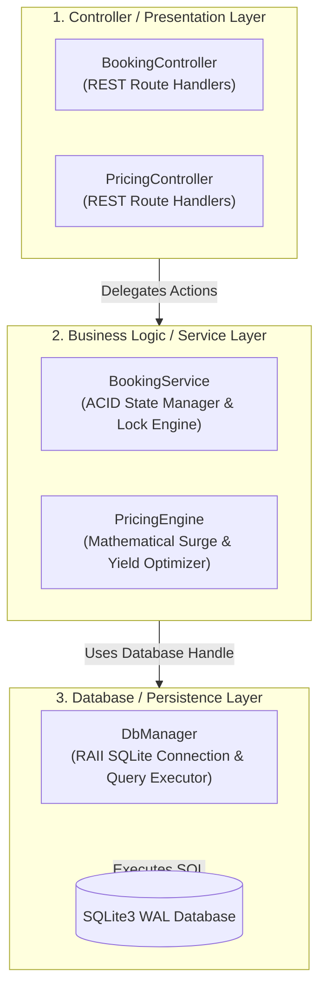
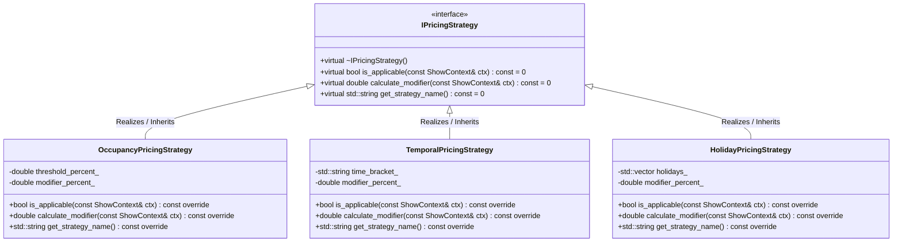
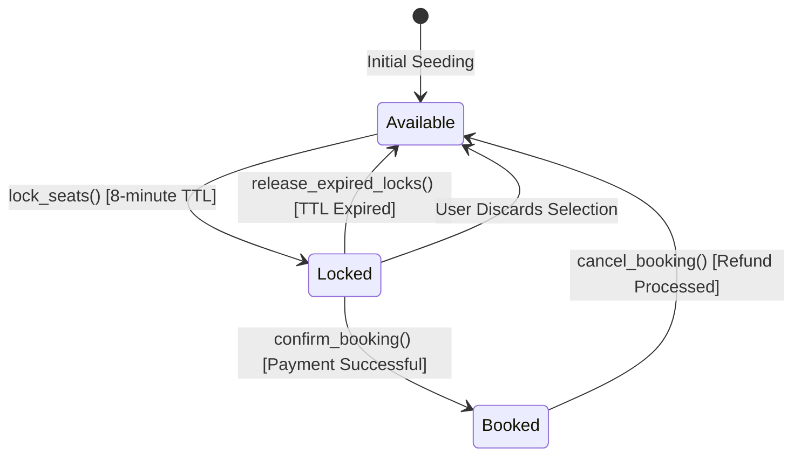
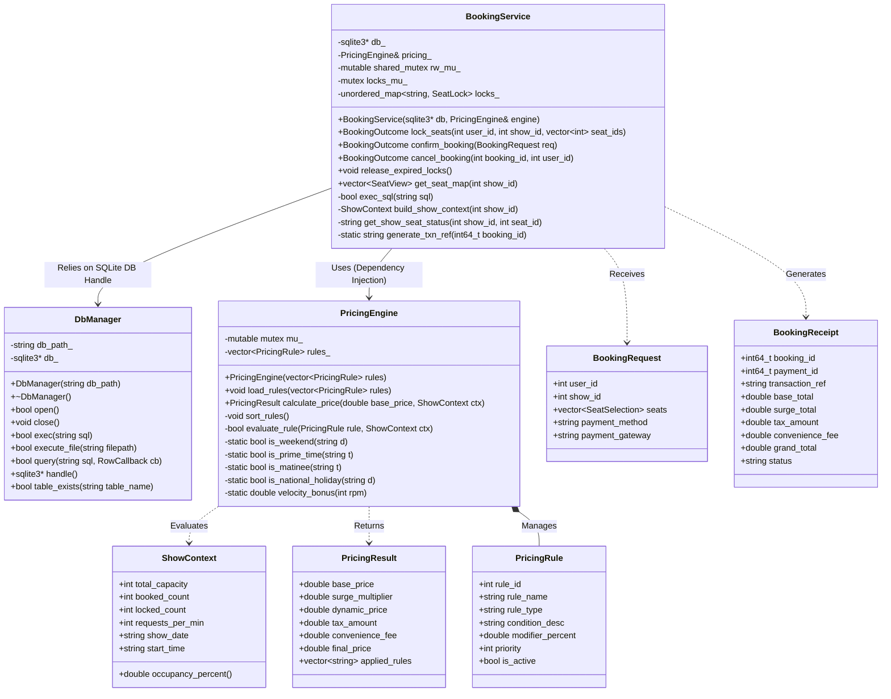
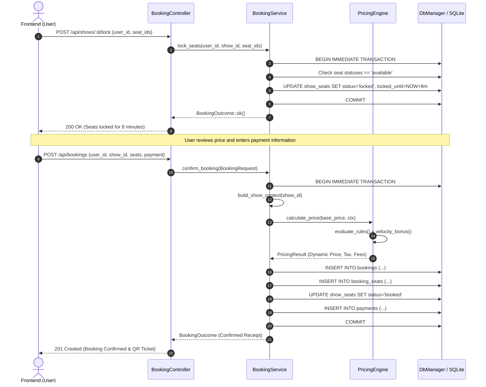

# 🎬 AuraCinemas — C++ Object-Oriented Programming (OOP) Implementation Guide

> **Comprehensive Academic & Technical Reference for College Evaluation, Code Defense & Architecture Review**  
> **Course Context:** Object-Oriented Programming (C++20) / System Design (Semester Project)  
> **Repository:** `AuraCinemas` — Multiplex Booking Engine & Yield Management System  

---

## 📑 Table of Contents
1. [Architectural Overview & Layered Design](#1-architectural-overview--layered-design)
2. [Mapping of the 4 Core OOP Pillars](#2-mapping-of-the-4-core-oop-pillars)
   - [2.1 Encapsulation & Data Hiding](#21-encapsulation--data-hiding)
   - [2.2 Abstraction & Data Transfer Objects (DTOs)](#22-abstraction--data-transfer-objects-dtos)
   - [2.3 Polymorphism & Rule Evaluation Strategy](#23-polymorphism--rule-evaluation-strategy)
   - [2.4 Inheritance & Recommended Strategy Hierarchy](#24-inheritance--recommended-strategy-hierarchy)
3. [Deep Dive into Core Classes & Header Analysis](#3-deep-dive-into-core-classes--header-analysis)
   - [3.1 `DbManager` (Database Layer & RAII)](#31-dbmanager-database-layer--raii)
   - [3.2 `PricingEngine` (Dynamic Pricing Domain Model)](#32-pricingengine-dynamic-pricing-domain-model)
   - [3.3 `BookingService` (Transactional Service Layer & State Engine)](#33-bookingservice-transactional-service-layer--state-engine)
   - [3.4 Controllers (`BookingController` & `PricingController`)](#34-controllers-bookingcontroller--pricingcontroller)
4. [Mermaid UML Class Diagram](#4-mermaid-uml-class-diagram)
5. [Object Collaboration & Interaction Flow](#5-object-collaboration--interaction-flow)
6. [Design Patterns Implemented & Identified](#6-design-patterns-implemented--identified)
7. [Modern C++20 Idioms & Best Practices](#7-modern-c20-idioms--best-practices)
8. [Viva & Project Defense Q&A Cheatsheet](#8-viva--project-defense-qa-cheatsheet)

---

## 1. Architectural Overview & Layered Design

The C++ backend of **AuraCinemas** (`backend/src`) is engineered using a clean **Layered Architecture (3-Tier Architecture)** combined with object-oriented domain modeling:



### Key Architectural Responsibilities
- **Decoupled Responsibilities:** No controller touches raw SQL directly for bookings; all business logic, seat-lock TTL validations, and price computations are encapsulated inside `BookingService` and `PricingEngine`.
- **Thread-Safe Domain Models:** Modern cinemas experience high concurrency when popular movies open for booking. All services use synchronized memory constructs (`std::mutex`, `std::shared_mutex`, `std::atomic`).

---

## 2. Mapping of the 4 Core OOP Pillars

### 2.1 Encapsulation & Data Hiding
Encapsulation bundles data (attributes) and behavior (methods) into a class while restricting direct access to the internal state using visibility specifiers (`private`, `public`).

#### Implementation in Code:
1. **`DbManager` ([db_manager.hpp](file:///c:/Users/prath/OneDrive/Desktop/College%20SY-Sem1/Aura%20Cinemas/auracinemas/backend/src/database/db_manager.hpp)):**
   - The native C pointer `sqlite3* db_` and the connection path `std::string db_path_` are strictly `private`.
   - Outside callers cannot corrupt the connection or bypass settings like WAL mode or foreign key pragmas. Access is strictly controlled via methods `open()`, `close()`, `exec()`, and `query()`.
2. **`PricingEngine` ([pricing_engine.hpp](file:///c:/Users/prath/OneDrive/Desktop/College%20SY-Sem1/Aura%20Cinemas/auracinemas/backend/src/services/pricing_engine.hpp)):**
   - The list of active pricing rules `std::vector<PricingRule> rules_` and the mutex `mutable std::mutex mu_` are `private`.
   - Modifying rules requires calling `load_rules()`, which automatically acquires a lock and sorts rules by priority:
     ```cpp
     void load_rules(std::vector<PricingRule> rules) {
         std::lock_guard<std::mutex> lock(mu_);
         rules_ = std::move(rules);
         sort_rules();
     }
     ```
3. **`BookingService` ([booking_service.hpp](file:///c:/Users/prath/OneDrive/Desktop/College%20SY-Sem1/Aura%20Cinemas/auracinemas/backend/src/services/booking_service.hpp)):**
   - The in-memory hold cache `std::unordered_map<std::string, SeatLock> locks_` is private and protected by `locks_mu_`.
   - Callers cannot arbitrarily mark seats as booked without going through the two-phase validation pipeline (`lock_seats()` followed by `confirm_booking()`).

---

### 2.2 Abstraction & Data Transfer Objects (DTOs)
Abstraction hides complex implementation details and exposes only clean, high-level interfaces to the consumer.

#### Implementation in Code:
1. **Separation of Low-Level SQL from Domain Logic:**
   - Instead of writing SQLite C-APIs (`sqlite3_prepare_v2`, `sqlite3_step`, `sqlite3_column_*`) throughout the application, `DbManager::query()` provides a functional abstraction accepting a callback:
     ```cpp
     using RowCallback = std::function<void(sqlite3_stmt*)>;
     bool query(const std::string& sql, RowCallback cb);
     ```
2. **Data Transfer Objects (DTOs) as Typed Contracts:**
   - AuraCinemas defines lightweight `struct` definitions to represent clean domain boundaries without exposing relational database schemas directly:
     - `ShowContext`: Abstracts capacity, occupancy metrics, and temporal context.
     - `PricingResult`: Abstracts the financial breakdown (base price, surge multiplier, tax, convenience fee, final price, applied rules list).
     - `SeatSelection` & `BookingRequest`: Package seat IDs and payment details into a single cohesive entity.
     - `BookingOutcome`: Encapsulates return status (`BookingError`), error messages, and optional `BookingReceipt`.

---

### 2.3 Polymorphism & Rule Evaluation Strategy
Polymorphism allows objects of different types to be treated through a uniform interface or allows functions to behave differently based on parameters/runtime data.

#### Implementation in Code:
1. **Dynamic Rule Dispatching in `PricingEngine`:**
   - In `evaluate_rule(const PricingRule& rule, const ShowContext& ctx)`, the engine evaluates polymorphic rule categories at runtime:
     - **Occupancy Rules:** Evaluates percentage capacity (`occ < 40%`, `occ >= 90%`).
     - **Temporal Rules:** Evaluates date and time dimensions (`Weekend Surge`, `Prime Time Surge`, `Matinee Discount`).
     - **Special Event Rules:** Evaluates calendar exceptions (`National Holiday` such as Republic Day, Independence Day, Gandhi Jayanti).
2. **Parametric & Functional Polymorphism:**
   - `DbManager::query` uses `std::function<void(sqlite3_stmt*)>`, enabling any callable (lambda, function pointer, or functor) to consume result rows polymorphically without rewriting the cursor looping mechanism.

---

### 2.4 Inheritance & Recommended Strategy Hierarchy
While the current implementation encapsulates rule behavior inside rule-type branching for compact execution, the codebase is structurally designed to support classical object-oriented inheritance via the **Strategy Pattern**.

#### Classical OOP Inheritance Model for College Presentation:
To demonstrate pure virtual inheritance (`virtual ... = 0`) in an academic evaluation, the rule engine can be modeled as:



```cpp
// Pure Abstract Interface demonstrating runtime polymorphism (OOP)
class IPricingStrategy {
public:
    virtual ~IPricingStrategy() = default;
    virtual bool is_applicable(const ShowContext& ctx) const = 0;
    virtual double calculate_modifier(const ShowContext& ctx) const = 0;
    virtual std::string get_strategy_name() const = 0;
};

// Derived Concrete Class 1
class OccupancyPricingStrategy : public IPricingStrategy {
public:
    OccupancyPricingStrategy(double min_occ, double max_occ, double mod, std::string name)
        : min_occ_(min_occ), max_occ_(max_occ), modifier_(mod), name_(std::move(name)) {}

    bool is_applicable(const ShowContext& ctx) const override {
        double occ = ctx.occupancy_percent();
        return (occ >= min_occ_ && occ < max_occ_);
    }

    double calculate_modifier(const ShowContext&) const override {
        return modifier_;
    }

    std::string get_strategy_name() const override { return name_; }

private:
    double min_occ_;
    double max_occ_;
    double modifier_;
    std::string name_;
};
```

---

## 3. Deep Dive into Core Classes & Header Analysis

### 3.1 `DbManager` (Database Layer & RAII)
- **Header:** [backend/src/database/db_manager.hpp](file:///c:/Users/prath/OneDrive/Desktop/College%20SY-Sem1/Aura%20Cinemas/auracinemas/backend/src/database/db_manager.hpp)
- **Role:** Controls database connection lifecycle and provides thread-safe access.

#### OOP Highlights:
1. **Rule of Three / Five (Deleted Copy Semantics):**
   ```cpp
   // Prohibit copying to prevent double-free of sqlite3* pointer
   DbManager(const DbManager&) = delete;
   DbManager& operator=(const DbManager&) = delete;
   ```
2. **RAII (Resource Acquisition Is Initialization):**
   - Memory and operating system file descriptors are managed strictly: the destructor `~DbManager()` automatically invokes `close()`, closing `sqlite3* db_` cleanly without memory leaks.
3. **Database Configuration via Method Chaining:**
   - Enables SQLite Write-Ahead Logging (`WAL`), foreign keys, and 5000ms busy timeouts upon initialization.

---

### 3.2 `PricingEngine` (Dynamic Pricing Domain Model)
- **Header:** [backend/src/services/pricing_engine.hpp](file:///c:/Users/prath/OneDrive/Desktop/College%20SY-Sem1/Aura%20Cinemas/auracinemas/backend/src/services/pricing_engine.hpp)
- **Role:** High-performance calculation of ticket surge pricing, GST, and convenience fees.

#### Key Attributes & Methods:
| Member | Visibility | Description |
| :--- | :--- | :--- |
| `GST_RATE` (`0.18`) | `public static constexpr` | Indian statutory GST (18%) constant. |
| `CONVENIENCE_FEE` (`30.0`) | `public static constexpr` | Fixed booking platform fee. |
| `MAX_SURGE_MULTIPLIER` (`3.0`) | `public static constexpr` | Upper surge boundary (prevents unbounded inflation). |
| `MIN_SURGE_MULTIPLIER` (`0.70`) | `public static constexpr` | Floor discount boundary (protects theater margin). |
| `mu_` | `private mutable std::mutex` | Synchronizes access to rules collection. |
| `rules_` | `private std::vector<PricingRule>` | Active rule set sorted by priority. |
| `calculate_price(...)` | `public [[nodiscard]]` | Thread-safe pricing calculation function. |
| `evaluate_rule(...)` | `private [[nodiscard]]` | Evaluates rule criteria against `ShowContext`. |
| `velocity_bonus(...)` | `private static` | Dynamic surge addition based on requests per minute. |

#### Mathematical Pricing Formula:
$$\text{Surge Multiplier} = \text{clamp}\left(1.0 + \frac{\sum \text{Modifiers} + \text{VelocityBonus}}{100},\; 0.70,\; 3.00\right)$$
$$\text{Dynamic Price} = \text{round}(\text{Base Price} \times \text{Surge Multiplier})$$
$$\text{Final Price} = \text{Dynamic Price} + \text{Tax (18\%)} + \text{Convenience Fee (₹30)}$$

---

### 3.3 `BookingService` (Transactional Service Layer & State Engine)
- **Header:** [backend/src/services/booking_service.hpp](file:///c:/Users/prath/OneDrive/Desktop/College%20SY-Sem1/Aura%20Cinemas/auracinemas/backend/src/services/booking_service.hpp)
- **Role:** Orchestrates the 2-Phase Seat Reservation lifecycle (Hold Lock -> Confirmation).

#### Concurrency & State Machine:


#### OOP Highlights:
1. **Dependency Injection:**
   `BookingService` receives references to the database handle `sqlite3*` and the `PricingEngine&` via its constructor:
   ```cpp
   explicit BookingService(sqlite3* db, PricingEngine& engine)
       : db_(db), pricing_(engine) {}
   ```
2. **Reader-Writer Concurrency (`std::shared_mutex`):**
   - Read operations (e.g. `get_seat_map()`) use `std::shared_lock<std::shared_mutex>`, allowing dozens of concurrent users to view seat availability simultaneously.
   - Write operations (e.g. `lock_seats()`, `confirm_booking()`) acquire an exclusive `std::unique_lock<std::shared_mutex>` and start `BEGIN IMMEDIATE TRANSACTION` in SQLite to ensure atomic consistency.
3. **Background Daemon Thread:**
   - `main.cpp` spawns a dedicated background thread running `booking.release_expired_locks()` every 60 seconds to reap expired locks without blocking incoming HTTP requests.

---

### 3.4 Controllers (`BookingController` & `PricingController`)
- **Headers:** [booking_controller.hpp](file:///c:/Users/prath/OneDrive/Desktop/College%20SY-Sem1/Aura%20Cinemas/auracinemas/backend/src/controllers/booking_controller.hpp) & [pricing_controller.hpp](file:///c:/Users/prath/OneDrive/Desktop/College%20SY-Sem1/Aura%20Cinemas/auracinemas/backend/src/controllers/pricing_controller.hpp)
- **Role:** Web interface adapters that bind Crow HTTP endpoints to service methods, parse JSON requests, and format standardized JSON responses.

---

## 4. Mermaid UML Class Diagram



---

## 5. Object Collaboration & Interaction Flow

The following sequence demonstrates how objects collaborate across layers during a ticket reservation:



---

## 6. Design Patterns Implemented & Identified

1. **Dependency Injection (DI):**
   - `BookingService` does not instantiate `PricingEngine` or open its own raw database connection inside its methods. Instead, dependencies are passed through the constructor. This adheres to the **Inversion of Control (IoC)** principle and makes unit testing straightforward.
2. **RAII (Resource Acquisition Is Initialization):**
   - Connection handles in `DbManager` and lock guards (`std::lock_guard`, `std::unique_lock`, `std::shared_lock`) acquire resources upon construction and automatically release them upon destruction (even if an exception or early return occurs).
3. **Data Transfer Object (DTO) Pattern:**
   - `BookingRequest`, `BookingReceipt`, `ShowContext`, and `PricingResult` cleanly decouple the presentation layer from the persistence layer.
4. **Strategy Pattern (Dynamic Pricing):**
   - Rules are encapsulated as independent pricing strategies evaluated based on context rather than hardcoding business rules into the checkout loop.
5. **Separation of Concerns (MVC / Layered Architecture):**
   - Routing logic (`controllers/`) is cleanly decoupled from business rules (`services/`) and database access (`database/`).

---

## 7. Modern C++20 Idioms & Best Practices

- **Explicit Constructors (`explicit`):** Prevents unintended implicit type conversions (e.g., `explicit DbManager(const std::string& db_path)`).
- **`[[nodiscard]]` Attribute:** Applied to query methods like `calculate_price()`, `occupancy_percent()`, and `ok()` to instruct the compiler to emit a warning if the caller ignores the return value.
- **Move Semantics (`std::move`):** Used in `PricingEngine(std::vector<PricingRule> rules)` and `load_rules()` to avoid expensive vector copies.
- **Const Correctness (`const` methods):** Methods that do not alter the logical state of an object (`calculate_price`, `occupancy_percent`, `evaluate_rule`) are marked `const`.
- **Thread Synchronization (`<mutex>`, `<shared_mutex>`, `<atomic>`):** Employs read-write locking to maximize concurrent throughput.

---

## 8. Viva & Project Defense Q&A Cheatsheet

### Q1: Why did you delete the copy constructor in `DbManager`?
> **Answer:** "In C++, `sqlite3*` is a raw C pointer managing an operating system database handle. If `DbManager` were copied by value, two instances would hold the same pointer. When one object went out of scope, its destructor would close the connection, leaving the second object with a dangling pointer (leading to undefined behavior and double-free errors). Deleting the copy constructor enforces unique ownership under RAII."

### Q2: What is the difference between `std::mutex` and `std::shared_mutex` in your project?
> **Answer:** "`PricingEngine` uses `std::mutex` with `std::lock_guard` because rule recalculations and modifications are fast and infrequent. However, `BookingService` uses `std::shared_mutex`. This enables multiple concurrent users to execute read operations (like `get_seat_map()`) simultaneously via `std::shared_lock`, while write operations (like `lock_seats()` or `confirm_booking()`) acquire exclusive access via `std::unique_lock`."

### Q3: How does your dynamic pricing engine avoid negative prices or extreme price gouging?
> **Answer:** "We use `std::clamp` with bounded constants `MIN_SURGE_MULTIPLIER` ($0.70$) and `MAX_SURGE_MULTIPLIER` ($3.00$). Regardless of demand velocity or occupancy calculations, prices can never drop below a 30% discount floor (protecting operational costs) nor rise above a $3\times$ ceiling (preventing consumer exploitation)."

### Q4: Why did you separate `controllers/` from `services/`?
> **Answer:** "To adhere to the Single Responsibility Principle (SRP). `BookingController` is solely responsible for HTTP deserialization, status codes, and JSON formatting. `BookingService` is completely agnostic of HTTP and handles database transactions, seat availability validation, and hold timers. This allows the business logic to be tested independently or reused in a CLI interface without changing core logic."

### Q5: How is a seat hold implemented to prevent race conditions when two users click the same seat?
> **Answer:** "We use a 2-phase reservation model. In Step 1, `lock_seats()` starts an atomic SQLite transaction using `BEGIN IMMEDIATE`. It checks if `status == 'available'`. If available, it updates the status to `'locked'` with an 8-minute expiration timestamp (`locked_until`). If another user attempts to lock the same seat simultaneously, the transaction encounters a busy lock or reads status `'locked'` and returns a HTTP 409 Conflict."
