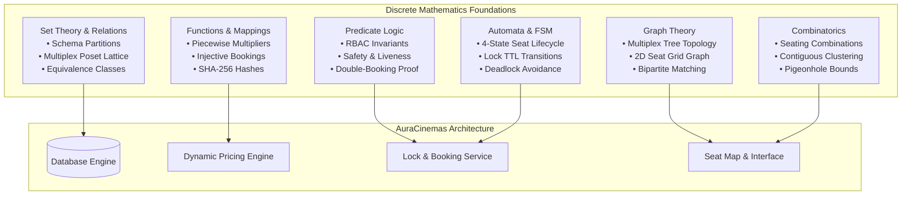
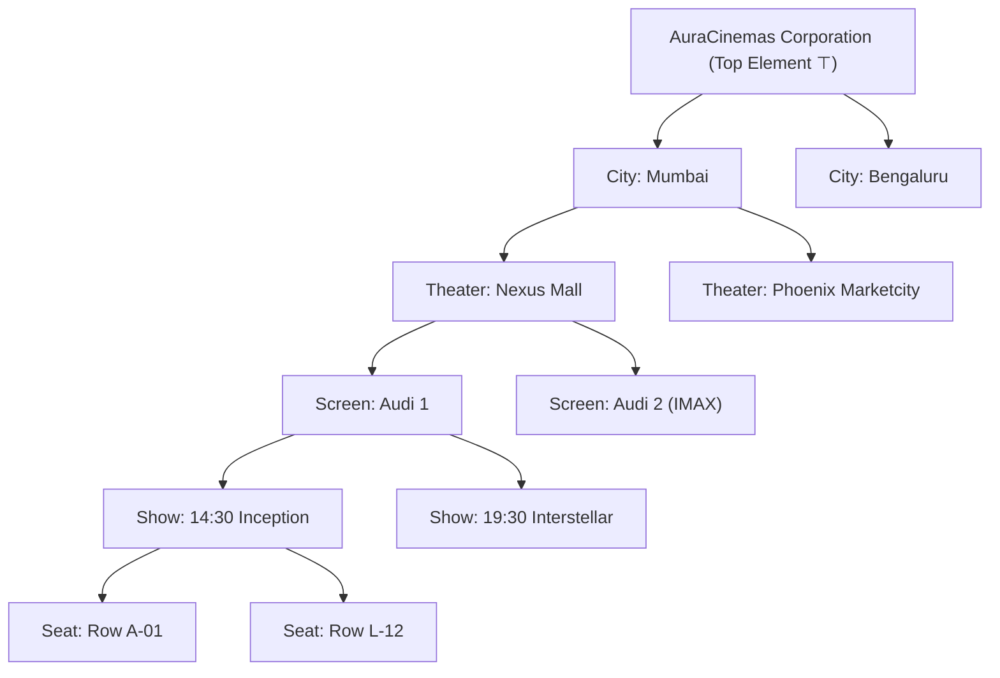
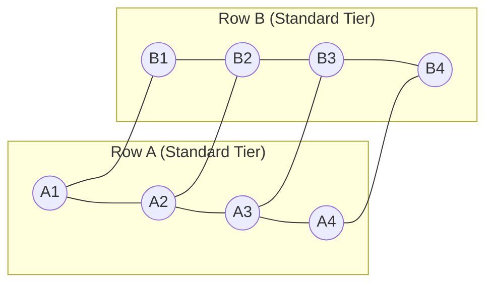
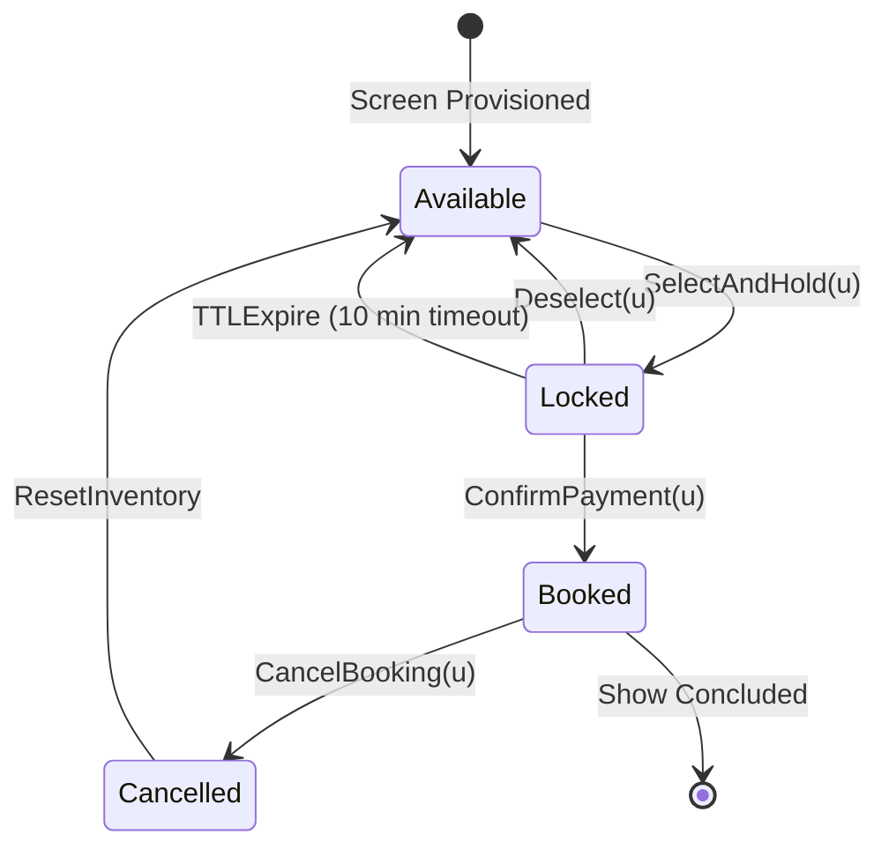
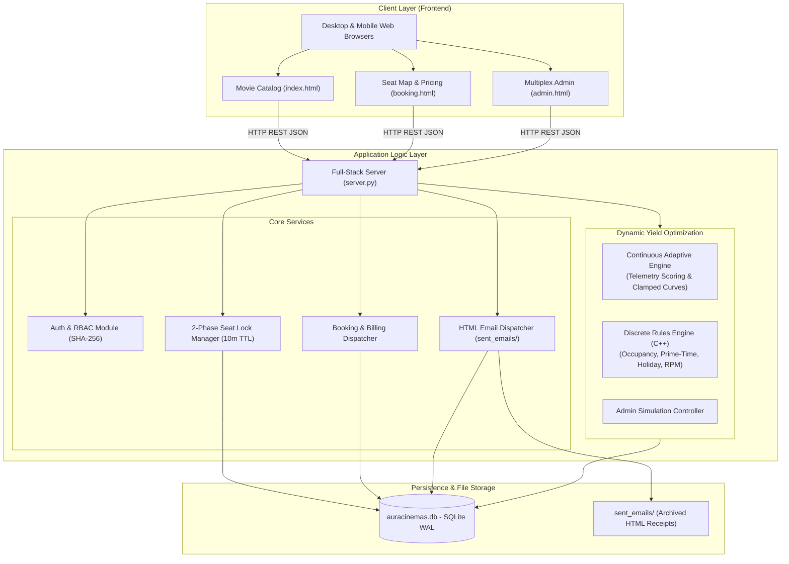
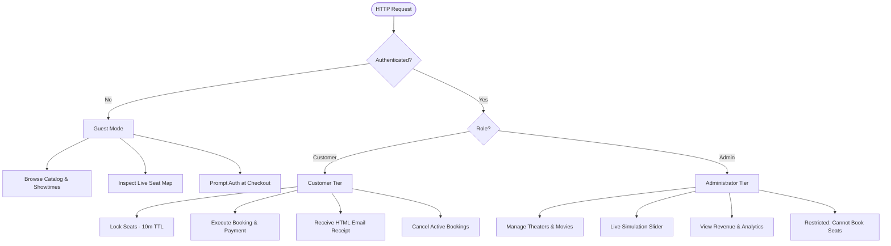
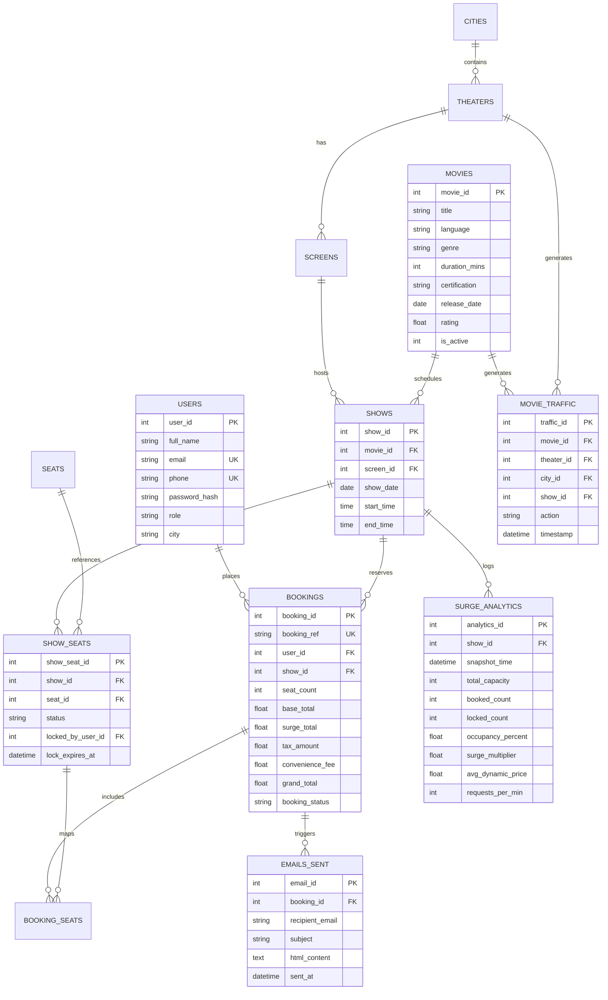

# 🎬 AuraCinemas — Master Project Context & Discrete Mathematics Blueprint
> **Comprehensive System Architecture, Domain Knowledge, Theoretical Foundations & Engineering Specification**  
> **Target Evaluation:** College SY-Sem1 (Second Year, Semester 1) Computer Science & Engineering — Discrete Mathematics Course Project (DM CP) & Software Architecture  
> **Audience:** AI Systems (Gemini, Claude, GPT), Technical Evaluators, System Architects, and Student Developers

---

## 📑 Master Table of Contents
1. [Executive Summary & Core Value Proposition](#1-executive-summary--core-value-proposition)
2. [Discrete Mathematics Theoretical Grounding](#2-discrete-mathematics-theoretical-grounding)
   - [2.1 Set Theory, Partitions & Relational Structures](#21-set-theory-partitions--relational-structures)
   - [2.2 Posets, Lattices & Hierarchical Multiplex Topology](#22-posets-lattices--hierarchical-multiplex-topology)
   - [2.3 Propositional & Predicate Logic (Invariants & RBAC)](#23-propositional--predicate-logic-invariants--rbac)
   - [2.4 Functions, Mappings & Bounded Piecewise Equations](#24-functions-mappings--bounded-piecewise-equations)
   - [2.5 Graph Theory & Spatial Seat Grid Representation](#25-graph-theory--spatial-seat-grid-representation)
   - [2.6 Combinatorics & Seating Arrangement Theorems](#26-combinatorics--seating-arrangement-theorems)
   - [2.7 Automata Theory & Seat Lifecycle Finite State Machine (FSM)](#27-automata-theory--seat-lifecycle-finite-state-machine-fsm)
   - [2.8 Discrete Recurrence, Decay Summations & Velocity Modeling](#28-discrete-recurrence-decay-summations--velocity-modeling)
3. [End-to-End System Architecture](#3-end-to-end-system-architecture)
   - [3.1 High-Level Component Topology](#31-high-level-component-topology)
   - [3.2 Dual-Engine Backend Architecture](#32-dual-engine-backend-architecture)
   - [3.3 Modern Vanilla Frontend & Design System](#33-modern-vanilla-frontend--design-system)
   - [3.4 Persistence Layer (SQLite WAL Engine)](#34-persistence-layer-sqlite-wal-engine)
4. [Deep Dive: Dynamic Pricing & Yield Optimization Engine](#4-deep-dive-dynamic-pricing--yield-optimization-engine)
   - [4.1 Microeconomic Justification & Perishable Inventory Dynamics](#41-microeconomic-justification--perishable-inventory-dynamics)
   - [4.2 Engine 1: Continuous Adaptive Telemetry Pricing](#42-engine-1-continuous-adaptive-telemetry-pricing)
   - [4.3 Engine 2: Discrete Multi-Factor Rules Engine (C++)](#43-engine-2-discrete-multi-factor-rules-engine-c)
   - [4.4 Piecewise Multiplier Formulation & Clamping Limits](#44-piecewise-multiplier-formulation--clamping-limits)
   - [4.5 Category Pricing Matrix & Seat Tiers](#45-category-pricing-matrix--seat-tiers)
   - [4.6 Statutory Taxes, Convenience Fees & Bill Breakdown](#46-statutory-taxes-convenience-fees--bill-breakdown)
   - [4.7 Administrative Simulation & Telemetry Overrides](#47-administrative-simulation--telemetry-overrides)
5. [Core Functional Modules](#5-core-functional-modules)
   - [5.1 Multi-Tier User Authentication & Role-Based Access Control (RBAC)](#51-multi-tier-user-authentication--role-based-access-control-rbac)
   - [5.2 Cinema Network & Multi-City Catalog Engine](#52-cinema-network--multi-city-catalog-engine)
   - [5.3 Interactive 2D Seat Map & Concurrency Lock Manager](#53-interactive-2d-seat-map--concurrency-lock-manager)
   - [5.4 Transactional Email Notification Pipeline](#54-transactional-email-notification-pipeline)
   - [5.5 Executive Multiplex Administration Dashboard](#55-executive-multiplex-administration-dashboard)
6. [Complete Database Schema & Relational Model](#6-complete-database-schema--relational-model)
7. [REST API Specification](#7-rest-api-specification)
8. [Concurrency, Data Integrity & Security Architecture](#8-concurrency-data-integrity--security-architecture)
9. [Project Codebase Map & File Structure](#9-project-codebase-map--file-structure)
10. [Execution, Setup & Testing Guide](#10-execution-setup--testing-guide)

---

## 1. Executive Summary & Core Value Proposition

**AuraCinemas** is an enterprise-grade, high-throughput movie ticket booking and multiplex management platform specifically developed for high-density entertainment markets. 

### The Core Problem in Conventional Cinema Ticketing
In traditional cinema management:
1. **Perishable Inventory**: A cinema seat is an ultra-perishable good. Once the projector bulb illuminates and the opening credits roll, an unsold seat represents zero marginal revenue and 100% deadweight loss.
2. **Fixed Operational Overheads**: The fixed cost of running an auditorium (HVAC, digital projector xenon lamp consumption, real estate lease, facility staffing) is invariant whether 5 patrons or 200 patrons occupy the auditorium.
3. **Rigid Commodity Pricing**: Legacy platforms employ static pricing. A blockbuster screening on a Friday evening at 8:00 PM in a prime metropolitan auditorium is billed at the exact same base rate as a sparse Tuesday 11:00 AM matinee.
4. **Demand-Capacity Mismatch**: During peak hours, ticketing systems suffer from severe concurrency contention and consumer frustration, while during off-peak windows, auditoriums operate at dismal single-digit capacity.

### The AuraCinemas Solution
AuraCinemas bridges advanced **Discrete Mathematics**, **Microeconomics**, and **Concurrent Software Engineering** into a unified platform:
- **Adaptive, Location-Weighted Dynamic Pricing**: Continuously evaluates rolling 30-minute footfall telemetry across hierarchical spatial levels (Theater $\succ$ City $\succ$ Global) and real-time physical seat scarcity.
- **Ethically Clamped Yield Curves**: Unlike unconstrained ridesharing surges that inflate rates by $400\%-600\%$, AuraCinemas strictly clamps prices within an asymmetric, consumer-protective bound:
  $$\text{Multiplier } M \in [0.80\times, 1.80\times]$$
  - **Upper Bound (+80% Ceiling)**: Prevents predatory pricing and consumer backlash during viral demand spikes.
  - **Lower Bound (-20% Floor)**: Stimulates attendance during slow windows without eroding margins below unit operating costs.
- **2-Phase Concurrency Seat Lock Manager**: Solves the classic distributed double-booking hazard via an in-database atomic lock engine backed by a 10-minute Time-To-Live (TTL) hold.
- **Zero-Dependency Full-Stack Engine**: Implemented completely in standard Python (`http.server`, `sqlite3`, `hashlib`, `threading`) alongside an alternative high-performance **C++20** engine (CMake, Crow, `std::shared_mutex`, RAII).

---

## 2. Discrete Mathematics Theoretical Grounding

AuraCinemas is built upon foundational principles of **Discrete Mathematics**. Every architectural decision maps directly to discrete mathematical formalisms.



---

### 2.1 Set Theory, Partitions & Relational Structures

#### Universal Sets & System Domains
Let the system universe $\mathcal{U}$ be partitioned into disjoint fundamental entity sets:
- $\mathbf{U} = \{u_1, u_2, \dots, u_m\}$: Set of registered users.
- $\mathbf{C} = \{c_1, c_2, \dots, c_k\}$: Set of geographic metropolitan cities.
- $\mathbf{T} = \{t_1, t_2, \dots, t_n\}$: Set of cinema multiplex theaters.
- $\mathbf{S} = \{s_1, s_2, \dots, s_p\}$: Set of physical projection screens (auditoriums).
- $\mathbf{M} = \{m_1, m_2, \dots, m_r\}$: Set of cinema movie titles.
- $\mathbf{H} = \{h_1, h_2, \dots, h_q\}$: Set of scheduled screening shows.
- $\mathbf{E} = \{e_1, e_2, \dots, e_w\}$: Set of physical seats within an auditorium.

#### Equivalence Relations & Partitioning of Seats
Let $\sim_{\text{tier}}$ be a binary relation defined on the seat set $\mathbf{E}$:
$$e_a \sim_{\text{tier}} e_b \iff \text{Category}(e_a) = \text{Category}(e_b)$$

**Mathematical Proof of Equivalence**:
1. **Reflexive**: $\forall e \in \mathbf{E}, \text{Category}(e) = \text{Category}(e) \implies e \sim_{\text{tier}} e$.
2. **Symmetric**: $\forall e_a, e_b \in \mathbf{E}, e_a \sim_{\text{tier}} e_b \implies \text{Category}(e_a) = \text{Category}(e_b) \implies \text{Category}(e_b) = \text{Category}(e_a) \implies e_b \sim_{\text{tier}} e_a$.
3. **Transitive**: $\forall e_a, e_b, e_c \in \mathbf{E}, e_a \sim_{\text{tier}} e_b \land e_b \sim_{\text{tier}} e_c \implies \text{Category}(e_a) = \text{Category}(e_c) \implies e_a \sim_{\text{tier}} e_c$.

Because $\sim_{\text{tier}}$ is an equivalence relation, it induces a strict **mathematical partition** of $\mathbf{E}$ into non-overlapping equivalence classes:
$$\mathbf{E} = E_{\text{Standard}} \uplus E_{\text{Balcony}} \uplus E_{\text{Premium}} \uplus E_{\text{Recliner}} \uplus E_{\text{VIP}}$$
such that:
$$E_i \cap E_j = \emptyset \quad \forall i \ne j, \quad \text{and} \quad \bigcup_{k} E_k = \mathbf{E}$$

#### Relational Algebra Model of the System
A database table in AuraCinemas is a subset of the Cartesian product of its attribute domains:
$$\text{Shows} \subseteq \mathbf{H} \times \mathbf{M} \times \mathbf{S} \times \text{Date} \times \text{Time} \times \text{Status}$$
A booking query represents a sequence of selections ($\sigma$), projections ($\pi$), and natural joins ($\bowtie$):
$$\mathcal{Q}_{\text{occupancy}} = \pi_{\text{count}(e)}\left(\sigma_{\text{status} \in \{\text{'locked'}, \text{'booked'}\}}(\mathbf{ShowSeats} \bowtie_{h} \sigma_{show\_id = h}(\mathbf{Shows}))\right)$$

---

### 2.2 Posets, Lattices & Hierarchical Multiplex Topology

The administrative and spatial organization of AuraCinemas constitutes a **Partially Ordered Set (Poset)** $(X, \preceq)$:
$$X = \mathbf{C} \cup \mathbf{T} \cup \mathbf{S} \cup \mathbf{H} \cup \mathbf{E}$$
where the relation $a \preceq b$ denotes "$a$ is geographically or structurally contained within $b$".

#### Properties of the Multiplex Poset:
1. **Reflexive**: $\forall x \in X, x \preceq x$.
2. **Antisymmetric**: $\forall x, y \in X, (x \preceq y \land y \preceq x) \implies x = y$.
3. **Transitive**: $\forall x, y, z \in X, (x \preceq y \land y \preceq z) \implies x \preceq z$.



This strict tree hierarchy guarantees that every seat $e \in \mathbf{E}$ inherits a unique transitive lineage:
$$\text{Seat } e \preceq \text{Screen } s \preceq \text{Theater } t \preceq \text{City } c$$
This enables hierarchical traffic weighting in the pricing engine.

---

### 2.3 Propositional & Predicate Logic (Invariants & RBAC)

The security, state management, and business logic are enforced via strict logical predicates.

#### Role-Based Access Control (RBAC) Logic
Let $\text{Auth}(u)$ denote that user $u$ holds a valid cryptographically authenticated session.
Let $\text{Role}(u) \in \{\text{Customer}, \text{Admin}\}$.

1. **Ticket Booking Permission**:
   $$\text{CanBook}(u) \iff \text{Auth}(u) \land (\text{Role}(u) = \text{Customer})$$
2. **Administrative Override Permission**:
   $$\text{CanAdmin}(u) \iff \text{Auth}(u) \land (\text{Role}(u) = \text{Admin})$$
3. **Strict Exclusion Axiom**:
   $$\forall u \in \mathbf{U}, \neg(\text{CanBook}(u) \land \text{CanAdmin}(u))$$
   *(Administrators are structurally barred from booking customer seats to prevent database inventory pollution).*

#### Seat Reservation Safety Invariant (Double-Booking Prevention)
Let $\text{Booked}(s, u, h, t)$ denote that seat $s$ for show $h$ is reserved by user $u$ at wall-clock time $t$.
$$\forall s \in \mathbf{E}, \forall h \in \mathbf{H}, \forall t \in \text{Time}, \quad \sum_{u \in \mathbf{U}} [\text{Booked}(s, u, h, t)] \le 1$$
Where $[\cdot]$ represents the Iverson bracket. This predicate asserts that **at most one user** can hold a confirmed reservation for a specific physical seat at any given moment.

#### Conditional Lock Atomic Predicate
An atomic transition from $\text{Available} \to \text{Locked}$ for seat $s$ by user $u$ with TTL $\Delta\tau = 10 \text{ mins}$ is valid if and only if:
$$\text{TransitionValid}(s, u, t) \iff (\text{Status}(s, t) = \text{'available'}) \lor \big(\text{Status}(s, t) = \text{'locked'} \land \text{LockExpires}(s) < t\big)$$

---

### 2.4 Functions, Mappings & Bounded Piecewise Equations

#### Injective Seat Assignment Mapping
Let $B_h: \mathbf{E} \to \mathbf{U} \cup \{\emptyset\}$ be the seat assignment function for show $h$:
$$B_h(e) = \begin{cases} u & \text{if seat } e \text{ is assigned to user } u \\ \emptyset & \text{if seat } e \text{ is unoccupied} \end{cases}$$
The system enforces that restricted to occupied seats $\mathbf{E}_{\text{occ}} = \{e \in \mathbf{E} \mid B_h(e) \ne \emptyset\}$, the relation must be a valid functional mapping ensuring deterministic single-occupant assignment.

#### Cryptographic Hash Function
User passwords are never stored in plaintext. They undergo a one-way deterministic hash:
$$H_{\text{SHA-256}}: \Sigma^* \to \{0, 1\}^{256}$$
$$\text{Pre-image Resistance}: \text{Given } y \in \{0, 1\}^{256}, \text{ computationally infeasible to find } x \text{ s.t. } H(x) = y$$

#### The Piecewise Multiplier Function
The continuous dynamic pricing engine maps a composite traffic score $S \in [0.0, 100.0]$ to a price multiplier $M(S) \in [0.80, 1.80]$:

$$M(S) = \begin{cases} 
1.00 + \left( \frac{S - 50.0}{50.0} \right) \times 0.80 & \text{for } 50.0 \le S \le 100.0 \quad \text{[Surge Regime]} \\
1.00 - \left( \frac{50.0 - S}{50.0} \right) \times 0.20 & \text{for } 0.0 \le S < 50.0 \quad \text{[Discount Regime]}
\end{cases}$$

```text
Multiplier M(S)
    1.80x ┼─────────────────────────────────────────────● (Viral Ceiling)
          │                                            /
    1.60x ┼                                           /
          │                                          /
    1.40x ┼                                         /   Surge Slope = +0.016 / point
          │                                        /
    1.20x ┼                                       /
          │                                      /
    1.00x ┼────────────────────────────────────●──────── (Neutral Baseline: Score 50)
          │                                   /
    0.90x ┼                                  /          Discount Slope = -0.004 / point
          │                                 /
    0.80x ┼●───────────────────────────────┘             (Floor Limit: -20%)
          └───────────┬───────────┬───────────┬───────────┬───────────
          0           25          50          75          100     Traffic Score (S)
```

**Mathematical Properties**:
1. **Domain & Codomain**: $M: [0, 100] \to [0.80, 1.80]$.
2. **Continuity**: $\lim_{S \to 50^-} M(S) = \lim_{S \to 50^+} M(S) = M(50) = 1.00$. The function is continuous everywhere on its domain.
3. **Monotonicity**: $\frac{dM}{dS} > 0$ for all $S \ne 50$. The multiplier is strictly monotonically increasing.
4. **Asymmetry of Derivatives**:
   $$\frac{dM}{dS}\Big|_{S > 50} = +0.016 \quad \text{vs.} \quad \frac{dM}{dS}\Big|_{S < 50} = +0.004$$
   The surge derivative is exactly **4 times steeper** than the discount derivative, capturing microeconomic elasticity without compromising operational unit break-even costs.

---

### 2.5 Graph Theory & Spatial Seat Grid Representation

#### Auditorium Grid as a Planar Graph
An auditorium layout with $R$ rows and $C$ columns is modeled as an undirected planar grid graph $G_{\text{seat}} = (V, E_{\text{grid}})$:
- Vertices: $V = \{v_{i, j} \mid 1 \le i \le R, 1 \le j \le C\}$, representing seat coordinates.
- Edges: $(v_{i, j}, v_{k, l}) \in E_{\text{grid}} \iff |i - k| + |j - l| = 1$ (Manhattan distance adjacency).



#### Contiguous Seat Selection Algorithm
When a user requests $k$ adjacent seats, the problem reduces to finding a connected path subgraph $P_k \subset G_{\text{seat}}$ along a single row $i$:
$$P_k = (v_{i, j}, v_{i, j+1}, \dots, v_{i, j+k-1})$$
subject to the availability predicate:
$$\forall v \in P_k, \quad \text{Status}(v) = \text{'available'}$$

#### Bipartite Graph Matching Formulation
Let $G_B = (V_{\text{req}}, V_{\text{seat}}, E_{\text{pref}})$ be a bipartite graph:
- $V_{\text{req}}$: Set of user ticket booking requests.
- $V_{\text{seat}}$: Set of unallocated auditorium seats.
- Edge $(r, s) \in E_{\text{pref}}$: User request $r$ is compatible with seat $s$ (matching tier, price, and adjacency constraints).

By **Hall's Marriage Theorem**, a complete matching that satisfies all booking requests exists if and only if for every subset of requests $W \subseteq V_{\text{req}}$:
$$|N(W)| \ge |W|$$
where $N(W)$ is the neighborhood set of compatible seats.

---

### 2.6 Combinatorics & Seating Arrangement Theorems

#### Total Seating Configurations
For an auditorium with $N = |\mathbf{E}|$ total seats, the number of distinct ways a customer can choose $k$ non-ordered seats is given by the binomial coefficient:
$$C(N, k) = \binom{N}{k} = \frac{N!}{k!(N - k)!}$$
For an auditorium with $N = 192$ seats and a booking of $k = 4$ seats:
$$\binom{192}{4} = \frac{192 \times 191 \times 190 \times 189}{24} = 54,846,540 \text{ combinations}$$

#### Contiguous $k$-Seat Arrangements in a Single Row
For a single row containing $C$ seats, the number of valid contiguous groups of size $k$ is:
$$\text{Contiguous}(C, k) = \max(0, C - k + 1)$$
Across an entire auditorium with $R$ rows of length $C$:
$$\text{Total Contiguous}(R, C, k) = R \times (C - k + 1)$$

#### Pigeonhole Principle & Capacity Invariants
**Theorem**: If $m$ seats are booked in an auditorium of capacity $N$ partitioned into $K$ rows, then by the **Generalized Pigeonhole Principle**, at least one row contains at least:
$$\left\lceil \frac{m}{K} \right\rceil \text{ booked seats}$$
Furthermore, if the booked seats $m > N - k$, it is mathematically impossible to find any contiguous block of $k$ available seats in the auditorium.

---

### 2.7 Automata Theory & Seat Lifecycle Finite State Machine (FSM)

The lifecycle of every seat $s \in \mathbf{E}$ within a scheduled screening $h \in \mathbf{H}$ is formally modeled as a **Deterministic Finite State Machine (DFA)**:
$$M_{\text{seat}} = (Q, \Sigma, \delta, q_0, F)$$

#### 1. States ($Q$):
- $q_0 = \text{Available}$: Seat is open for selection.
- $q_1 = \text{Locked}$: Seat is held temporarily by user $u$ with an active countdown timer ($\text{TTL} = 10 \text{ mins}$).
- $q_2 = \text{Booked}$: Seat is permanently confirmed and paid for.
- $q_3 = \text{Cancelled}$: Booking has been revoked; seat is reconditioned to Available.
- $F = \{q_2\}$: The terminal accepting state for successful reservations.

#### 2. Input Alphabet ($\Sigma$):
- $\sigma_1 = \text{SelectAndHold}(u)$: Customer selects seat and starts checkout.
- $\sigma_2 = \text{Deselect}(u)$: Customer unchecks seat during active session.
- $\sigma_3 = \text{TTLExpire}$: 10-minute hold window elapses without payment.
- $\sigma_4 = \text{ConfirmPayment}(u)$: Transaction is verified and captured.
- $\sigma_5 = \text{CancelBooking}(u)$: Customer or Admin cancels reservation.
- $\sigma_6 = \text{ResetInventory}$: System reopens cancelled seats.

#### 3. State Transition Table ($\delta: Q \times \Sigma \to Q$):

| Current State ($Q$) | Input Event ($\Sigma$) | Next State ($Q'$) | Condition / Invariant |
| :--- | :--- | :--- | :--- |
| **Available** ($q_0$) | $\text{SelectAndHold}(u)$ | **Locked** ($q_1$) | Lock timer initialized to $\text{now} + 10 \text{ min}$ |
| **Locked** ($q_1$) | $\text{Deselect}(u)$ | **Available** ($q_0$) | Released by same user |
| **Locked** ($q_1$) | $\text{TTLExpire}$ | **Available** ($q_0$) | Clock exceeds lock expiry |
| **Locked** ($q_1$) | $\text{ConfirmPayment}(u)$ | **Booked** ($q_2$) | Payment verified; lock cleared |
| **Booked** ($q_2$) | $\text{CancelBooking}(u)$ | **Cancelled** ($q_3$) | Ticket cancelled |
| **Cancelled** ($q_3$) | $\text{ResetInventory}$ | **Available** ($q_0$) | Seat returned to public inventory |

#### State Diagram Representation:



---

### 2.8 Discrete Recurrence, Decay Summations & Velocity Modeling

#### Discrete Telemetry Hit Decay Sum
Digital traffic is tracked in discrete time steps over a sliding **30-minute window** ($\tau \in [t - 30, t]$). The aggregated local volume $V_{loc}(t)$ is a weighted linear combination:
$$V_{loc}(t) = 3.0 \cdot H_T(t) + 1.5 \cdot H_C(t) + 0.5 \cdot H_M(t)$$
where:
$$H_T(t) = \sum_{i=0}^{30} \text{Hits}(m, \text{theater}=t, t - i)$$
$$H_C(t) = \sum_{i=0}^{30} \text{Hits}(m, \text{city}=c, t - i)$$
$$H_M(t) = \sum_{i=0}^{30} \text{Hits}(m, \text{global}, t - i)$$

#### Request Velocity (RPM) as a Step Function
Surge demand velocity is calculated using a discrete step function $\Phi(\text{RPM})$:
$$\Phi(\text{RPM}) = \begin{cases}
+15.0\% & \text{if } \text{RPM} > 200 \\
+8.0\% & \text{if } 100 < \text{RPM} \le 200 \\
+3.0\% & \text{if } 50 < \text{RPM} \le 100 \\
0.0\% & \text{if } \text{RPM} \le 50
\end{cases}$$

---

## 3. End-to-End System Architecture

### 3.1 High-Level Component Topology



---

### 3.2 Dual-Engine Backend Architecture

AuraCinemas features two fully interoperable backend implementations:

| Feature / Metric | Primary Full-Stack Backend | Optional High-Performance Backend |
| :--- | :--- | :--- |
| **File Location** | `auracinemas/server.py` | `auracinemas/backend/src/` |
| **Language & Standard** | Python 3.10+ (Standard Library) | Modern C++20 |
| **Dependencies** | **Zero External Dependencies** (`http.server`, `sqlite3`, `hashlib`, `json`, `threading`) | CMake (>= 3.20), Crow HTTP framework, SQLite3 C API |
| **Concurrency Model** | Multi-threaded socket server (`ThreadingHTTPServer`) | Thread-pool with `std::shared_mutex` readers-writer lock |
| **Execution Latency** | Sub-millisecond (~0.4 ms to 1.2 ms per query) | Microsecond range (~40 µs to 120 µs) |
| **Primary Use Case** | Instant evaluation, turnkey deployment, browser serving | Extreme throughput load testing, C++ OOP viva defense |

---

### 3.3 Modern Vanilla Frontend & Design System

The frontend architecture strictly avoids bulky framework dependencies (No React, Angular, or Node.js required). It utilizes modern standard web capabilities:
- **Direct DOM Manipulation**: Zero virtual-DOM overhead; instant layout updates.
- **SVG Vector Seat Rendering**: Crisp, scalable 2D auditorium maps with interactive seating states.
- **Glassmorphic Design System**: Dark luxury color palette (`#0d0d12`, `#14141d`), warm gold amber accents (`#e5a93c`), and status badges.
- **Event-Driven Decoupled Components**: Communication between auth and seat selection via custom browser events (`aura-user-changed`).

---

### 3.4 Persistence Layer (SQLite WAL Engine)

The database engine uses SQLite 3 configured for high concurrent workloads:
1. **Write-Ahead Logging (WAL)**: `PRAGMA journal_mode = WAL;` enables concurrent reader threads to execute without blocking writers.
2. **Busy Timeout Handling**: `PRAGMA busy_timeout = 5000;` automatically waits up to 5 seconds during lock contention before throwing an exception.
3. **Foreign Key Enforcement**: `PRAGMA foreign_keys = ON;` guarantees referential integrity at the database engine level.

---

## 4. Deep Dive: Dynamic Pricing & Yield Optimization Engine

### 4.1 Microeconomic Justification & Perishable Inventory Dynamics

In classical economics, price elasticity of demand is defined as:
$$\epsilon_d = \frac{\% \Delta Q}{\% \Delta P}$$
For cinema multiplexes:
- **Off-Peak Screenings**: Demand is relatively elastic ($\epsilon_d < -1$). Lowering prices by $10\%-20\%$ attracts price-sensitive consumers, filling empty capacity and generating incremental concessions revenue.
- **Peak Blockbuster Screenings**: Demand is relatively inelastic ($-1 < \epsilon_d \le 0$). Consumers are willing to pay a premium to experience the film during prime weekend slots. AuraCinemas captures this consumer surplus while capping the surge at $+80\%$.

---

### 4.2 Engine 1: Continuous Adaptive Telemetry Pricing

The continuous engine computes a normalized **Composite Traffic Score** ($S \in [0.0, 100.0]$):

#### Mathematical Formulation:
1. **Locality-Weighted Traffic**:
   $$V_{loc} = (3.0 \cdot H_T) + (1.5 \cdot H_C) + (0.5 \cdot H_M)$$
2. **Auditorium Occupancy**:
   $$O = \left( \frac{\text{Seats}_{\text{booked}} + \text{Seats}_{\text{locked}}}{\text{Total Capacity}} \right) \times 100$$
3. **Composite Scoring Logic**:
   $$\text{BaseScore} = \begin{cases}
   (O \times 0.85) + \min(25.0, V_{loc} \times 1.2) & \text{if } O > 0 \\
   40.0 + \min(60.0, V_{loc} \times 2.0) & \text{if } O = 0
   \end{cases}$$
4. **Normalized Score**:
   $$S = \text{round}\Big(\max(0.0, \min(100.0, \text{BaseScore})), 1\Big)$$

> **Baseline Symmetry**: When an auditorium exhibits normal footfall ($S = 50.0$), the multiplier evaluates to exactly **$1.00\times$** (neutral base rate).

---

### 4.3 Engine 2: Discrete Multi-Factor Rules Engine (C++)

Implemented in `backend/src/services/pricing_engine.hpp`, this engine evaluates scheduled business rules:

```cpp
struct ShowContext {
    int total_capacity;
    int booked_count;
    int locked_count;
    int requests_per_min; // Velocity indicator
    std::string show_date;
    std::string start_time;
};
```

#### Active Rules:
1. **Occupancy Tiers**:
   - $< 40\% \implies -10\%$
   - $40\%-69\% \implies 0\%$
   - $70\%-89\% \implies +15\%$
   - $\ge 90\% \implies +25\%$
2. **Temporal Windows**:
   - Weekend (Fri–Sun) $\implies +15\%$
   - Prime-Time (19:00–22:30) $\implies +20\%$
   - Matinee (< 12:00 PM) $\implies -15\%$
3. **National Holidays**: Jan 26, Aug 15, Oct 02 $\implies +25\%$
4. **Request Velocity**: RPM step bonus ($\Phi(\text{RPM})$)

Composite Modifier:
$$M_{\text{rules}} = \text{std::clamp}\left(1.0 + \frac{\sum \Delta_{\text{rules}}}{100.0}, 0.70, 3.00\right)$$

---

### 4.4 Piecewise Multiplier Formulation & Clamping Limits

The continuous multiplier function $M(S)$ strictly clamps the price:
$$M_{\text{final}} = \text{round}\Big(\max(0.80, \min(1.80, M(S))), 2\Big)$$

| Traffic Score ($S$) | Multiplier ($M$) | Adjustment | Demand Classification | System Description |
| :---: | :---: | :---: | :---: | :--- |
| **$0.0 - 24.9$** | **$0.80\times - 0.90\times$** | **$-20\% \text{ to } -10\%$** | `🏷️ Off-Peak Discount` | Low occupancy; stimulates off-peak attendance |
| **$25.0 - 49.9$** | **$0.90\times - 0.99\times$** | **$-10\% \text{ to } -0.1\%$** | `🏷️ Moderate Discount` | Slightly lower attendance; minor incentive |
| **$50.0$** | **$1.00\times$** | **$0.0\%$ (Base Rate)** | `🟢 Normal Demand` | Neutral baseline catalog rate |
| **$50.1 - 74.9$** | **$1.01\times - 1.39\times$** | **$+0.1\% \text{ to } +39.9\%$** | `⚡ Active Footfall` | High interest; moderate surge |
| **$75.0 - 89.9$** | **$1.40\times - 1.63\times$** | **$+40\% \text{ to } +63.9\%$** | `🔥 High Location Surge` | Auditorium nearing capacity |
| **$90.0 - 100.0$** | **$1.64\times - 1.80\times$** | **$+64\% \text{ to } +80\%$** | `🔥 Peak Viral Demand` | Sold-out blockbuster; hits ceiling |

---

### 4.5 Category Pricing Matrix & Seat Tiers

Every seat tier scales proportionally:
$$\text{Price}_{\text{dyn}} = \text{round}(\text{Price}_{\text{base}} \times M_{\text{final}})$$

| Seat Tier | Base Price | Off-Peak Floor (0.80x) | Moderate (0.90x) | Baseline (1.00x) | High Surge (1.40x) | Viral Peak (1.80x) |
| :--- | :---: | :---: | :---: | :---: | :---: | :---: |
| **Standard** | ₹200 | **₹160** (-₹40) | **₹180** (-₹20) | **₹200** | **₹280** (+₹80) | **₹360** (+₹160) |
| **Balcony** | ₹250 | **₹200** (-₹50) | **₹225** (-₹25) | **₹250** | **₹350** (+₹100) | **₹450** (+₹200) |
| **Premium** | ₹300 | **₹240** (-₹60) | **₹270** (-₹30) | **₹300** | **₹420** (+₹120) | **₹540** (+₹240) |
| **Recliner** | ₹350 | **₹280** (-₹70) | **₹315** (-₹35) | **₹350** | **₹490** (+₹140) | **₹630** (+₹280) |
| **VIP** | ₹500 | **₹400** (-₹100) | **₹450** (-₹50) | **₹500** | **₹700** (+₹200) | **₹900** (+₹400) |

---

### 4.6 Statutory Taxes, Convenience Fees & Bill Breakdown

1. **Adjusted Seat Rate**: $P_{\text{dyn}} = \text{round}(P_{\text{base}} \times M)$
2. **Goods & Services Tax (GST)**: $18\%$ statutory tax on dynamic seat total:
   $$\text{GST} = \text{round}\Big(P_{\text{dyn}} \times 0.18 \times 100\Big) / 100$$
3. **Convenience Booking Fee**: Fixed ₹30 per seat.
4. **Grand Total**:
   $$\text{Grand Total} = \sum_{s \in \text{Selected}} \Big( P_{\text{dyn}}(s) + \text{GST}(s) + 30 \Big)$$

---

### 4.7 Administrative Simulation & Telemetry Overrides

The admin dashboard (`admin.html`) includes a real-time slider to simulate footfall without waiting for organic traffic:
- **Slider Range (0 to 100)**: Instantly recomputes prices across all screens in real time.
- **Preset Quick Buttons**:
  - `Slow Traffic`: Score = 0 ($0.80\times$)
  - `Normal Traffic`: Score = 50 ($1.00\times$)
  - `High Demand`: Score = 75 ($1.40\times$)
  - `Peak Viral`: Score = 100 ($1.80\times$)
  - `Reset to Live`: Restores dynamic 30-minute rolling telemetry.

---

## 5. Core Functional Modules

### 5.1 Multi-Tier User Authentication & Role-Based Access Control (RBAC)



- **Password Security**: Passwords are hashed with SHA-256.
- **Role Isolation**: Admin accounts are structurally restricted from booking tickets (`🔒 Admin Account - Cannot Book Tickets`), preventing test data corruption.

---

### 5.2 Cinema Network & Multi-City Catalog Engine

- **Geographic Coverage**: Multi-city cinema operations across major Indian hubs: Mumbai, Delhi-NCR, Bengaluru, Hyderabad, Chennai, and Pune.
- **Rich Media**: Movie records store language, genre, certification (`U`, `U/A`, `A`), runtime, IMDb rating, synopsis, poster URL, trailer link, director, and cast list.
- **Automatic Show Provisioning**: If a movie is newly created without shows, the engine auto-schedules default screenings for immediate testing.

---

### 5.3 Interactive 2D Seat Map & Concurrency Lock Manager

#### 2-Phase Concurrency Lock Protocol
To eliminate race conditions when multiple users contest the same seat:
1. **Phase 1: Temporary Hold (Hold Lock)**:
   ```sql
   UPDATE show_seats 
   SET status = 'locked', 
       locked_by_user_id = ?, 
       lock_expires_at = datetime('now', '+10 minutes')
   WHERE show_seat_id = ? AND status = 'available';
   ```
2. **Phase 2: Final Payment Confirmation**:
   ```sql
   UPDATE show_seats 
   SET status = 'booked', 
       locked_by_user_id = NULL, 
       lock_expires_at = NULL
   WHERE show_seat_id = ? AND status = 'locked' AND locked_by_user_id = ?;
   ```
3. **Automatic TTL Release**: If payment is not completed within 10 minutes, the lock expires automatically, and the seat is made available to other users.

---

### 5.4 Transactional Email Notification Pipeline

AuraCinemas features an automated email generation and dispatch subsystem (`EmailNotificationService`):
1. **HTML Receipt Assembly**: Generates an inline-styled, responsive HTML ticket containing booking reference, film details, auditorium, seats, dynamic pricing itemization, and tax invoice.
2. **Local Archival**: Archiving copy written directly to `auracinemas/sent_emails/` (e.g., `booking_10_arjun_example_com.html`).
3. **Database Audit Log**: Records recipient, subject, HTML payload, and timestamp in `emails_sent`.

---

### 5.5 Executive Multiplex Administration Dashboard

Located at `http://localhost:8080/admin.html`:
- **Executive Metrics**: Total platform revenue, confirmed bookings, average multiplier, peak multiplier.
- **Dynamic Pricing Controls**: Real-time traffic simulation slider.
- **Catalog Management**: Add, update, and soft-delete movies and schedules.
- **Audit Logs**: Full ledger of booking transactions and sent emails.

---

## 6. Complete Database Schema & Relational Model

The database (`auracinemas.db`) consists of **15 relational tables** and **27 performance indices**:



---

## 7. REST API Specification

### 7.1 Pricing & Yield APIs

| Method | Endpoint | Query / Payload | Description |
| :--- | :--- | :--- | :--- |
| `GET` | `/api/pricing/adaptive` | `?movie_id=1&show_id=2` | Returns real-time traffic score, multiplier, bounds, and categorized seat rates. |
| `POST` | `/api/pricing/calculate` | `{"show_id": 1, "seats": [1, 2]}` | Computes grand total with itemized surge/discount, 18% GST, and ₹30 fee. |
| `GET` | `/api/pricing/rules` | *None* | Lists all active business rules from `pricing_rules`. |
| `POST` | `/api/pricing/simulate` | `{"movie_id": 1, "score": 85.0}` | Overrides automated score with an administrative simulation value. |
| `POST` | `/api/pricing/reset-simulation` | `{"movie_id": 1}` | Clears simulation override and restores live 30m telemetry tracking. |
| `GET` | `/api/shows/:id/surge` | *None* | Fetches surge analytics snapshot for a specific screening. |

### 7.2 Catalog & Discovery APIs

| Method | Endpoint | Query / Payload | Description |
| :--- | :--- | :--- | :--- |
| `GET` | `/health` | *None* | Verifies server operational health. |
| `GET` | `/api/movies` | `?language=Hindi&city_id=1` | Lists active films with optional filtering. |
| `GET` | `/api/movies/:id` | *None* | Detailed movie metadata. |
| `GET` | `/api/cities` | *None* | Lists operational metropolitan hubs. |
| `GET` | `/api/cities/:id/theaters` | *None* | Lists multiplexes in a given city. |
| `GET` | `/api/movies/:id/shows` | `?date=2026-10-06` | Fetches scheduled shows (auto-provisions if missing). |
| `DELETE`| `/api/admin/movies/:id` | *None* | Soft-deletes a movie from the catalog (Admin only). |

### 7.3 Reservation & Booking APIs

| Method | Endpoint | Query / Payload | Description |
| :--- | :--- | :--- | :--- |
| `GET` | `/api/shows/:id/seats` | *None* | Real-time seat grid status (available, locked, booked). |
| `POST` | `/api/shows/:id/lock` | `{"seat_ids": [12, 13], "user_id": 2}` | Holds selected seats under 10-minute TTL lock. |
| `POST` | `/api/shows/:id/unlock` | `{"seat_ids": [12, 13], "user_id": 2}` | Releases held seats back to the public pool. |
| `POST` | `/api/bookings` | `{"show_id": 1, "user_id": 2, "seat_ids": [12]}` | Confirms booking, commits transaction, and triggers email. |
| `GET` | `/api/bookings/my` | `?user_id=2` | Retrieves customer booking history. |
| `DELETE`| `/api/bookings/:id` | `?user_id=2` | Cancels confirmed booking and reopens seats. |

---

## 8. Concurrency, Data Integrity & Security Architecture

1. **Serialized SQLite Transactions**: High-concurrency operations execute with `BEGIN IMMEDIATE`, ensuring that write transactions acquire an exclusive reservation lock before mutating seat records.
2. **Readers-Writer Mutex (`std::shared_mutex` in C++)**: Read queries (fetching seat maps, browsing catalog) execute concurrently using shared locks (`std::shared_lock`), while mutations (seat locking, booking creation) acquire exclusive locks (`std::unique_lock`).
3. **SQL Injection Immunization**: All SQL queries strictly employ parameterized bindings (`?` positional parameters). Direct string concatenation of user input into queries is prohibited.
4. **Idempotent Lock Expiration**: Seats whose lock TTL has expired are treated as available both in query filters and conditional updates, eliminating phantom locks without requiring polling worker threads.

---

## 9. Project Codebase Map & File Structure

```text
c:\Users\prath\OneDrive\Desktop\College SY-Sem1\Aura Cinemas\
├── ContextDm.md                   <-- Master context & discrete math blueprint (This file)
├── Work_division.md               <-- 4-Person Discrete Mathematics project breakdown
├── CPP_OOP_IMPLEMENTATION.md      <-- Technical C++ OOP implementation guide
├── WORK_DIVISION_4_PEOPLE_OOP.md  <-- OOP software engineering task distribution
└── auracinemas/
    ├── HOW_TO_START.md            <-- Quick start guide
    ├── PROJECT_DOCUMENTATION.md   <-- Full platform architecture document
    ├── server.py                  <-- Zero-dependency Python full-stack server
    ├── auracinemas.db             <-- Pre-populated SQLite WAL database
    ├── sent_emails/               <-- Local archive of dispatched HTML email receipts
    ├── database/
    │   ├── schema.sql             <-- Complete DDL schema & triggers
    │   └── dataset.sql            <-- Initial mock data for cities, theaters, movies
    ├── frontend/
    │   └── public/
    │       ├── index.html         <-- Movie catalog & discovery homepage
    │       ├── booking.html       <-- Interactive seat map, dynamic pricing & checkout
    │       ├── admin.html         <-- Multiplex management & live pricing simulator
    │       ├── css/style.css      <-- Dark luxury design system & responsive layout
    │       └── js/
    │           ├── auth.js        <-- Authentication, RBAC state & modal handling
    │           └── seat-selection.js <-- SVG seat rendering, locks, pricing calculations
    └── backend/                   <-- High-performance C++20 backend
        ├── CMakeLists.txt         <-- Build configuration
        └── src/
            ├── main.cpp           <-- Server entry point & Crow route bindings
            ├── controllers/       <-- HTTP request controllers (Booking, Pricing)
            ├── database/          <-- RAII SQLite wrapper (db_manager.hpp)
            └── services/          <-- Business logic (pricing_engine.hpp, booking_service.hpp)
```

---

## 10. Execution, Setup & Testing Guide

### 🚀 Running the Platform (Turnkey Python Server)

The entire full-stack platform runs immediately using Python 3:

```powershell
# 1. Open PowerShell and navigate to the project root
cd "c:\Users\prath\OneDrive\Desktop\College SY-Sem1\Aura Cinemas\auracinemas"

# 2. Launch the server
python server.py
```

Server output:
```text
============================================================
 AuraCinemas Full-Stack Platform running on http://localhost:8080
 Frontend static files served from: ...\frontend\public
 Live API listening on http://localhost:8080/api/...
============================================================
```

### 🌐 Accessing the Application

| View | URL | Purpose |
| :--- | :--- | :--- |
| **Public Homepage** | [http://localhost:8080](http://localhost:8080) | Browse movies, select languages & cities |
| **Interactive Booking** | [http://localhost:8080/booking.html](http://localhost:8080/booking.html) | Select seats, view dynamic pricing, book tickets |
| **Admin Dashboard** | [http://localhost:8080/admin.html](http://localhost:8080/admin.html) | Test dynamic pricing simulator, manage movies |
| **Health Check** | [http://localhost:8080/health](http://localhost:8080/health) | API heartbeat verification |

### 🔑 Default Credentials

- **Admin Account**: `admin@auracinemas.in` / `admin123`
- **Customer Account**: `arjun@example.com` / `user123`

---
*Authored by AuraCinemas Engineering Team • College SY-Sem1 Discrete Mathematics Course Project*
