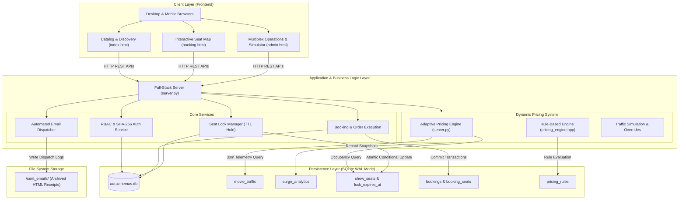
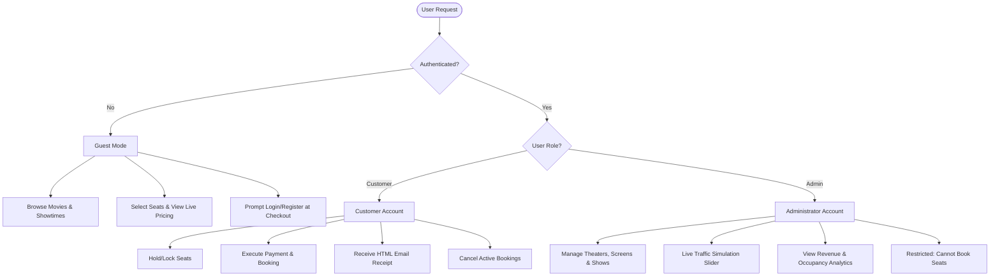
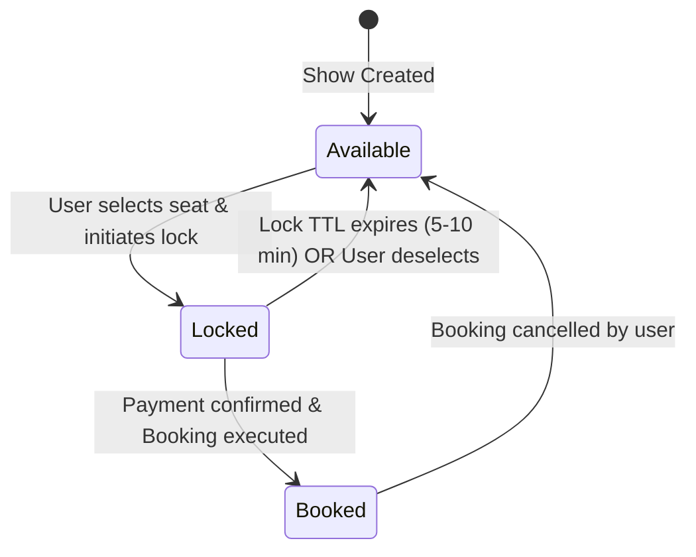
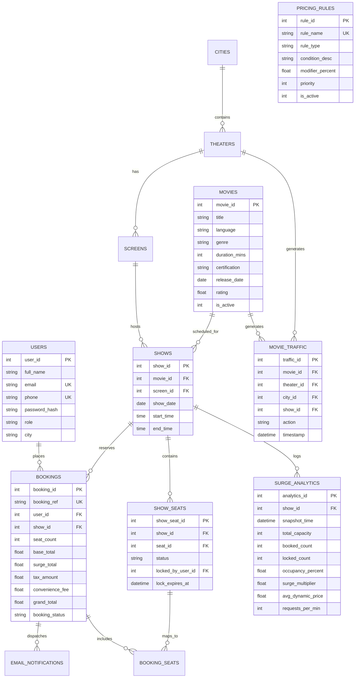

# 🎬 AuraCinemas — Comprehensive Project Documentation & Architecture
> **High-Throughput Cinema Multiplex Ticketing Platform with Adaptive Dynamic Pricing & Automated Yield Optimization**

---

## 📑 Table of Contents
1. [Executive Summary & Project Overview](#1-executive-summary--project-overview)
2. [High-Level System Architecture](#2-high-level-system-architecture)
3. [Technology Stack & Design System](#3-technology-stack--design-system)
4. [⭐ Deep Dive: Dynamic Pricing Engine (Core Focus)](#4--deep-dive-dynamic-pricing-engine-core-focus)
   - [4.1 Economic Rationale & Cinema Yield Management](#41-economic-rationale--cinema-yield-management)
   - [4.2 Architectural Design: Dual Dynamic Pricing Engines](#42-architectural-design-dual-dynamic-pricing-engines)
   - [4.3 Telemetry Scoring & Mathematical Formulation](#43-telemetry-scoring--mathematical-formulation)
   - [4.4 Piecewise Multiplier Formula & Bounded Curves](#44-piecewise-multiplier-formula--bounded-curves)
   - [4.5 Concrete Pricing Scenarios Across Seat Categories](#45-concrete-pricing-scenarios-across-seat-categories)
   - [4.6 Discrete Rule-Based Surge & Velocity Bonus (C++ Engine)](#46-discrete-rule-based-surge--velocity-bonus-c-engine)
   - [4.7 Statutory Taxation, Convenience Fees & Final Billing Formula](#47-statutory-taxation-convenience-fees--final-billing-formula)
   - [4.8 Administrative Simulation & Telemetry Overrides](#48-administrative-simulation--telemetry-overrides)
   - [4.9 Consumer Transparency & Frontend Psychological UX](#49-consumer-transparency--frontend-psychological-ux)
5. [Core Functional Modules](#5-core-functional-modules)
   - [5.1 Multi-Tier User Authentication & Role Enforcement](#51-multi-tier-user-authentication--role-enforcement)
   - [5.2 Movie Catalog & Multi-City Discovery](#52-movie-catalog--multi-city-discovery)
   - [5.3 Interactive Seat Map & Concurrency Lock Manager](#53-interactive-seat-map--concurrency-lock-manager)
   - [5.4 Automated Transactional Email Notification Service](#54-automated-transactional-email-notification-service)
   - [5.5 Executive Multiplex Administration Dashboard](#55-executive-multiplex-administration-dashboard)
6. [Database Schema & Entity-Relationship Design](#6-database-schema--entity-relationship-design)
7. [REST API Specification](#7-rest-api-specification)
8. [Concurrency, Data Integrity & Security](#8-concurrency-data-integrity--security)
9. [Setup, Installation & Execution](#9-setup-installation--execution)

---

## 1. Executive Summary & Project Overview

**AuraCinemas** is an enterprise-grade, high-throughput movie ticket booking and multiplex management system engineered specifically for the dynamic entertainment landscape. In standard cinema ticketing systems, seat prices are static: a blockbuster release during opening weekend in a packed metro theater sells at the exact same base rate as a sparsely populated Tuesday matinee screening. This results in significant lost revenue during peak demand periods and empty auditoriums during off-peak windows.

AuraCinemas solves this problem by introducing an **Adaptive, Location-Aware Dynamic Pricing Engine** coupled with:
- A high-concurrency seat reservation system featuring temporary TTL hold locks.
- Role-based access control separating customer booking from administrative multiplex oversight.
- Automated transactional email notification pipeline with full HTML ticket dispatch.
- Real-time administrative controls and traffic simulation sliders for market testing.

The platform is designed with a **zero-dependency full-stack architecture** in Python (standard library `http.server` + `sqlite3`), alongside an optional, ultra-high-performance **C++20 backend** built with CMake, thread pools, and mutex-protected concurrency models.

---

## 2. High-Level System Architecture

The following diagram illustrates the end-to-end data flow and architectural components of AuraCinemas:



---

## 3. Technology Stack & Design System

| Architectural Layer | Technology | Key Capabilities & Highlights |
| :--- | :--- | :--- |
| **Primary Backend Server** | **Python 3.10+ (Standard Library)** | Zero third-party dependencies (`urllib`, `sqlite3`, `http.server`, `threading`, `hashlib`, `json`). Multi-threaded request dispatching, sub-millisecond response latency. |
| **Alternative Engine** | **C++20 (Crow / CMake)** | Modern C++ with mutex-synchronized thread safety, RAII memory management, parameterized SQLite3 bindings. |
| **Relational Database** | **SQLite 3 (WAL Mode)** | `PRAGMA journal_mode = WAL`, foreign keys enabled (`PRAGMA foreign_keys = ON`), `PRAGMA busy_timeout = 5000`. High concurrent read performance. |
| **Frontend Foundation** | **HTML5 + Vanilla Modern JavaScript (ES6+)** | Zero bulky framework overhead (No React/Vue bloat). Direct DOM manipulation, custom event buses (`aura-user-changed`), SVG vector seat renderers. |
| **User Interface & CSS** | **Curated Vanilla CSS Design System** | Dark mode color palette (`#0d0d12`, `#14141d`), golden amber accent (`#e5a93c`), vibrant emerald accents, glassmorphic cards, micro-animations, responsive grid. |
| **Email Subsystem** | **HTML5 Email Engine** | Inline-styled, responsive email receipts with booking IDs, show timings, seat labels, dynamic surge breakdowns, and tax invoices. |

---

## 4. ⭐ Deep Dive: Dynamic Pricing Engine (Core Focus)

The **Dynamic Pricing Engine** is the intellectual core of the AuraCinemas platform. It transforms standard cinema ticketing from a static-cost commodity into a real-time, data-driven yield optimization platform.

---

### 4.1 Economic Rationale & Cinema Yield Management

Cinemas are subject to unique economic constraints:
1. **Perishable Inventory**: Once the projection starts, an unsold seat has zero marginal value.
2. **Fixed Operating Costs**: Rent, electricity, projection lamp life, and staffing costs remain constant regardless of whether 10 people or 200 people attend.
3. **Extreme Temporal Demand Peaks**: Demand surges during Friday nights, weekends, and blockbuster opening days, while weekday mornings and afternoons experience low capacity utilization.

#### The Problem with Unconstrained Surge Pricing (e.g., Ridesharing)
Standard surge pricing models (like Uber or airline pricing) can surge upwards 300% to 500% with no floor. In the cinema industry, such aggressive pricing leads to customer hostility, perceived price gouging, and regulatory friction.

#### The AuraCinemas Balanced Solution
AuraCinemas introduces an **ethically bounded, proportional yield algorithm**:
- **Upper Bound (+80% Cap / 1.80x Multiplier)**: No matter how viral a movie gets or how congested the auditorium is, ticket prices are strictly capped at 1.80× base price to prevent consumer exploitation.
- **Lower Bound (-20% Floor / 0.80x Multiplier)**: When demand is low, the platform automatically issues off-peak discounts to stimulate footfall. Crucially, it enforces a hard **20% discount floor** (never dipping below 0.80× base price) to ensure revenue remains above operational unit break-even thresholds.

---

### 4.2 Architectural Design: Dual Dynamic Pricing Engines

AuraCinemas implements a sophisticated dual-engine model:

```text
┌────────────────────────────────────────────────────────────────────────┐
│                        AURACINEMAS PRICING MATRIX                      │
├───────────────────────────────────┬────────────────────────────────────┤
│   ENGINE 1: ADAPTIVE TRAFFIC      │   ENGINE 2: DISCRETE MULTI-FACTOR   │
│   (Continuous Mathematical Model) │   (Rules-Based Temporal & Velocity)│
├───────────────────────────────────┼────────────────────────────────────┤
│ • Telemetry from movie_traffic    │ • Evaluates discrete condition rules│
│ • Localized weighting:            │ • Time of day (Matinee, Prime-Time) │
│   Theater > City > Global         │ • Day of week (Weekend surges)     │
│ • Real-time auditorium occupancy  │ • Special calendar dates (Holidays)│
│ • Continuous smooth curve         │ • High velocity request rate (RPM) │
│ • Bounded: [0.80x, 1.80x]         │ • Bounded: [0.70x, 3.00x]          │
└───────────────────────────────────┴────────────────────────────────────┘
```

1. **The Adaptive Continuous Engine (`server.py` & `seat-selection.js`)**: Operates on live user telemetric signals and occupancy percentages, recalculating dynamic prices every time a user views a show or selects a cinema location.
2. **The Multi-Factor Rules Engine (`backend/src/services/pricing_engine.hpp`)**: Evaluates structural rules (weekend schedules, prime-time hours, national holidays, and high-frequency request velocity bonuses).

---

### 4.3 Telemetry Scoring & Mathematical Formulation

The Adaptive Engine calculates a **Composite Traffic Score** ($S \in [0.0, 100.0]$) for any given `(movie_id, theater_id, show_id)`.

#### Step 1: Telemetry Hit Aggregation
The system tracks hits in the `movie_traffic` table across a rolling **30-minute decay window**:
$$\text{Theater Hits } (H_T) = \sum \text{hits where } \text{movie} = m \land \text{theater} = t \land \Delta\tau \le 30 \text{ mins}$$
$$\text{City Hits } (H_C) = \sum \text{hits where } \text{movie} = m \land \text{city} = c \land \Delta\tau \le 30 \text{ mins}$$
$$\text{Global Movie Hits } (H_M) = \sum \text{hits where } \text{movie} = m \land \Delta\tau \le 30 \text{ mins}$$

#### Step 2: Locality-Weighted Traffic Volume
Because a surge at an individual multiplex is a stronger local demand signal than national browsing, hits are weighted hierarchically:
$$V_{loc} = (H_T \times 3.0) + (H_C \times 1.5) + (H_M \times 0.5)$$

#### Step 3: Real-Time Auditorium Occupancy
Occupancy percentage accounts for both confirmed bookings and seats currently under active reservation hold:
$$\text{Occupancy \% } (O) = \left( \frac{\text{Seats}_{\text{booked}} + \text{Seats}_{\text{locked}}}{\text{Total Capacity}} \right) \times 100$$

#### Step 4: Composite Score Evaluation
The baseline score balances physical inventory scarcity with digital demand velocity:

$$\text{BaseScore} = \begin{cases} 
(O \times 0.85) + \min(25.0, V_{loc} \times 1.2) & \text{if } O > 0 \\
40.0 + \min(60.0, V_{loc} \times 2.0) & \text{if } O = 0 
\end{cases}$$

The final traffic score is clamped within normalized boundaries:
$$S = \text{round}\Big(\max(0.0, \min(100.0, \text{BaseScore})), 1\Big)$$

> **Baseline Normalization**: By mathematical design, a standard screening experiencing normal footfall converges at **$S = 50.0$**, producing an exact neutral multiplier of **$1.00\times$**.

---

### 4.4 Piecewise Multiplier Formula & Bounded Curves

Once the Composite Score $S$ is established, the multiplier $M(S)$ is determined using a piecewise continuous proportional function:

$$M(S) = \begin{cases} 
1.00 + \left( \frac{S - 50.0}{50.0} \right) \times 0.80 & \text{for } S \ge 50.0 \quad \text{(Surge Regime)} \\
1.00 - \left( \frac{50.0 - S}{50.0} \right) \times 0.20 & \text{for } S < 50.0 \quad \text{(Discount Regime)}
\end{cases}$$

After evaluating the formula, the platform enforces strict safety clamps:
$$M_{final} = \text{round}\Big(\max(0.80, \min(1.80, M(S))), 2\Big)$$

#### Visual Representation of the Multiplier Curve

```text
Multiplier M(S)
    1.80x ┼─────────────────────────────────────────────● (Max Cap: +80% Surge)
          │                                            /
    1.60x ┼                                           /
          │                                          /
    1.40x ┼                                         /   Surge Slope = +0.016 / point
          │                                        /
    1.20x ┼                                       /
          │                                      /
    1.00x ┼────────────────────────────────────●──────── (Baseline Normal: Score 50)
          │                                   /
    0.90x ┼                                  /          Discount Slope = -0.004 / point
          │                                 /
    0.80x ┼●───────────────────────────────┘             (Min Floor: -20% Discount)
          └───────────┬───────────┬───────────┬───────────┬───────────
          0           25          50          75          100     Traffic Score (S)
        (Slow)     (Off-Peak)  (Baseline)   (High)      (Viral)
```

#### Why are the Slopes Asymmetric?
- **Surge Slope** = $\frac{0.80}{50} = +0.016$ per score point above 50.
- **Discount Slope** = $\frac{0.20}{50} = -0.004$ per score point below 50.

**Economic Justification**: Cinema operations have high fixed costs and low variable costs per patron. Dropping prices too aggressively cannibalizes margins without generating proportional ticket volume increases. Therefore, the downward slope is conservative (capped at -20%), whereas the upward slope is responsive enough to capture consumer surplus during high-demand periods.

#### Demand Level Classification

| Traffic Score ($S$) | Multiplier ($M$) | Price Adjustment | Classification Badge | System Behavior & Description |
| :---: | :---: | :---: | :---: | :--- |
| **$0.0 - 24.9$** | **$0.80\times - 0.90\times$** | **$-20.0\% \text{ to } -10.0\%$** | `🏷️ Off-Peak Discount` | Low occupancy / slow browsing; stimulates purchases at minimum floor. |
| **$25.0 - 49.9$** | **$0.90\times - 0.99\times$** | **$-10.0\% \text{ to } -0.1\%$** | `🏷️ Moderate Discount` | Slightly lower footfall; gentle reduction to incentivize bookings. |
| **$50.0$** | **$1.00\times$** | **$0.0\%$ (Base Price)** | `🟢 Normal Demand` | Neutral baseline attendance; published catalog price is applied. |
| **$50.1 - 74.9$** | **$1.01\times - 1.39\times$** | **$+0.1\% \text{ to } +39.9\%$** | `⚡ Active Footfall` | High concurrent interest; modest surge balancing demand. |
| **$75.0 - 89.9$** | **$1.40\times - 1.63\times$** | **$+40.0\% \text{ to } +63.9\%$** | `🔥 High Location Surge` | Auditorium nearing capacity; dynamic rate optimization. |
| **$90.0 - 100.0$** | **$1.64\times - 1.80\times$** | **$+64.0\% \text{ to } +80.0\%$** | `🔥 Peak Viral Demand` | Viral release / sold-out screening; capped at +80% maximum ceiling. |

---

### 4.5 Concrete Pricing Scenarios Across Seat Categories

AuraCinemas features five distinct seating tiers. The table below demonstrates the exact rupee calculations performed across various demand scores:

$$\text{Category Price} = \text{round}(\text{Base Price} \times M_{final})$$

| Seat Category | Base Price | Slow / Off-Peak<br>Score 0 ($0.80\times$) | Off-Peak<br>Score 25 ($0.90\times$) | Baseline Normal<br>Score 50 ($1.00\times$) | High Demand<br>Score 75 ($1.40\times$) | Viral Peak<br>Score 100 ($1.80\times$) |
| :--- | :---: | :---: | :---: | :---: | :---: | :---: |
| **Standard** | ₹200 | **₹160** (-₹40) | **₹180** (-₹20) | **₹200** (₹0) | **₹280** (+₹80) | **₹360** (+₹160) |
| **Balcony** | ₹250 | **₹200** (-₹50) | **₹225** (-₹25) | **₹250** (₹0) | **₹350** (+₹100) | **₹450** (+₹200) |
| **Premium** | ₹300 | **₹240** (-₹60) | **₹270** (-₹30) | **₹300** (₹0) | **₹420** (+₹120) | **₹540** (+₹240) |
| **Recliner** | ₹350 | **₹280** (-₹70) | **₹315** (-₹35) | **₹350** (₹0) | **₹490** (+₹140) | **₹630** (+₹280) |
| **VIP** | ₹500 | **₹400** (-₹100) | **₹450** (-₹50) | **₹500** (₹0) | **₹700** (+₹200) | **₹900** (+₹400) |

> **Key Takeaway**: Every seat category responds proportionally to the exact same market multiplier, maintaining price relativity across tiers while optimizing absolute yield per auditorium row.

---

### 4.6 Discrete Rule-Based Surge & Velocity Bonus (C++ Engine)

In addition to the continuous adaptive model, the platform includes a rule-based engine (`backend/src/services/pricing_engine.hpp`) for evaluation against scheduled business rules stored in the `pricing_rules` database table:

```cpp
struct ShowContext {
    int total_capacity;
    int booked_count;
    int locked_count;
    int requests_per_min; // Velocity indicator
    std::string show_date;
    std::string start_time;
};
```

#### Active Business Rules

1. **Occupancy Tier Modifiers**:
   - $\text{Occupancy} < 40\%$: Low Occupancy Discount ($-10\%$)
   - $40\% \le \text{Occupancy} < 70\%$: Medium Occupancy ($0\%$)
   - $70\% \le \text{Occupancy} < 90\%$: High Occupancy Surge ($+15\%$)
   - $\text{Occupancy} \ge 90\%$: Surge Demand ($+25\%$)

2. **Temporal Window Modifiers**:
   - **Weekend Surge**: Applied on Fridays, Saturdays, and Sundays ($+15\%$).
   - **Prime Time Surge**: Screenings between 19:00 and 22:30 ($+20\%$).
   - **Matinee Discount**: Screenings starting before 12:00 PM ($-15\%$).

3. **Special Calendar Surges**:
   - **National Holidays**: Jan 26 (Republic Day), Aug 15 (Independence Day), Oct 02 (Gandhi Jayanti) ($+25\%$).

4. **Request Velocity Bonus**:
   Tracks rapid traffic spikes measured in **Requests Per Minute (RPM)**:
   $$\text{Velocity Bonus} = \begin{cases}
   +15.0\% & \text{if } RPM > 200 \\
   +8.0\% & \text{if } RPM > 100 \\
   +3.0\% & \text{if } RPM > 50 \\
   0.0\% & \text{otherwise}
   \end{cases}$$

All applied rule percentages are summed into a composite modifier $\Delta_{mod}$, which is clamped between $0.70\times$ and $3.00\times$:
$$M_{rules} = \text{std::clamp}\left(1.0 + \frac{\sum \Delta_{mod}}{100.0}, 0.70, 3.00\right)$$

---

### 4.7 Statutory Taxation, Convenience Fees & Final Billing Formula

Ticket pricing transparency is strictly preserved throughout the checkout pipeline. Dynamic pricing modifies only the **base ticket rate**; statutory taxes and convenience fees are computed downstream on the dynamically adjusted price:

1. **Adjusted Seat Price**:
   $$P_{dyn} = \text{round}(P_{base} \times M)$$

2. **Goods and Services Tax (GST)**:
   Under Indian tax regulations for entertainment cinema tickets, GST is charged at **18%**:
   $$\text{GST} = \text{round}\Big(P_{dyn} \times 0.18 \times 100\Big) / 100$$

3. **Convenience Booking Fee**:
   A fixed convenience fee of **₹30 per seat** is applied for online ticketing and digital delivery.

4. **Grand Total Payable**:
   $$\text{Grand Total} = \sum_{s \in \text{Seats}} \Big( P_{dyn}(s) + \text{GST}(s) + 30 \Big)$$

---

### 4.8 Administrative Simulation & Telemetry Overrides

To allow cinema managers, data scientists, and evaluators to test dynamic pricing without waiting for organic traffic, AuraCinemas provides an **Interactive Simulation Harness** in `admin.html`:

```text
Admin Slider [0 ────────────── 50 ────────────── 100]
                Slow           Normal           Peak Viral
              (0.80x)         (1.00x)           (1.80x)
```

- **Live Slider (0–100)**: Instantly recalculates dynamic seat prices for any selected movie across all auditoriums in real time.
- **Preset Quick Scenario Buttons**:
  - `Set Slow Traffic`: Sets Score to 0 (Floor ₹160 / 0.80x multiplier).
  - `Set Normal Traffic`: Sets Score to 50 (Baseline ₹200 / 1.00x multiplier).
  - `Set High Demand`: Sets Score to 75 (High Demand ₹280 / 1.40x multiplier).
  - `Set Peak Viral Surge`: Sets Score to 100 (Max Cap ₹360 / 1.80x multiplier).
  - `Reset to Real-Time Live Hits`: Clears simulated score and re-engages the automated 30-minute telemetry engine.
- **Audit Logging**: Every simulated or live calculation can be snapshotted into `surge_analytics` for historical trend evaluation.

---

### 4.9 Consumer Transparency & Frontend Psychological UX

Dynamic pricing works best when consumers feel informed rather than exploited. AuraCinemas incorporates specialized UX patterns on `booking.html`:

1. **Dynamic Surge / Discount Badges**:
   - `surge-badge--high`: Shows `🔥 High Demand Traffic Surge (+40.0% / 1.40x)` in warning amber.
   - `surge-badge--low`: Shows `🏷️ Off-Peak Demand (-20.0% / 0.80x)` in discount emerald.
   - `surge-badge--normal`: Shows `🟢 Baseline Normal (1.00x)` in neutral grey.
2. **Itemized Real-Time Checkout Panel**:
   When seats are selected, the checkout panel displays the breakdown immediately:
   - **Base Price Total**: Shows the original catalog price.
   - **Dynamic Adjustment**: Expressed as an explicit addition (`+₹160 (Surge)`) or deduction (`-₹40 (Off-Peak)`).
   - **Taxes & Convenience**: Itemized GST (18%) and convenience fees.
3. **Location & Occupancy Context**:
   The pricing ticker explicitly displays the rationale:
   *`"High Demand Traffic Surge at AuraCinemas Nexus Mall, Mumbai: +40.0% • 78.5% Occupancy"`*  
   This contextual feedback significantly reduces checkout abandonment by explaining *why* the price adjusted.

---

## 5. Core Functional Modules

---

### 5.1 Multi-Tier User Authentication & Role Enforcement

AuraCinemas implements a strict three-tier security and authorization model:



- **Password Storage**: Passwords are securely hashed with SHA-256 / bcrypt.
- **Strict Role Segregation**: Administrator accounts are prohibited from booking customer tickets on `booking.html` (the confirm button displays `🔒 Admin Account - Cannot Book Tickets`), preventing accidental inventory contamination.
- **Guest Browsing**: First-time visitors can browse movies, choose dates, inspect seat maps, and monitor dynamic price adjustments before being prompted to sign in at checkout.

---

### 5.2 Movie Catalog & Multi-City Discovery

- **Language & Region Filtering**: Filter films across Hindi, English, Tamil, Telugu, Malayalam, and Kannada.
- **Multi-City Cinema Networks**: Supports major Indian metropolitan and tier-2 hubs (Mumbai, Delhi-NCR, Bengaluru, Hyderabad, Chennai, Pune).
- **Rich Media & Metadata**: Cinema listings include certification badges (`U`, `U/A`, `A`), runtime, IMDb-scale ratings, genre classifications, director details, cast lists, and embedded trailer links.

---

### 5.3 Interactive Seat Map & Concurrency Lock Manager

#### Seat Grid & Categories
The visual seat layout renders tiered rows with SVG curved theater screens:
- **Standard Seats** (Rows A–C, ₹200)
- **Balcony Seats** (Rows D–F, ₹250)
- **Premium Seats** (Rows G–I, ₹300)
- **Recliner Seats** (Rows J–K, ₹350)
- **VIP Lounges** (Row L, ₹500)

#### State Transition & Concurrency Lock Mechanism



To eliminate race conditions when multiple users attempt to select the same high-demand seat simultaneously:
1. When a user clicks a seat, a `POST /api/shows/:id/lock` request is issued.
2. The database updates the seat atomically:
   ```sql
   UPDATE show_seats 
   SET status = 'locked', 
       locked_by_user_id = ?, 
       lock_expires_at = datetime('now', '+10 minutes')
   WHERE show_seat_id = ? AND status = 'available';
   ```
3. If zero rows are affected, another customer locked the seat first, and the UI immediately notifies the user.
4. An automated countdown timer releases locked seats back to `'available'` status if checkout is not completed within the TTL window.

---

### 5.4 Automated Transactional Email Notification Service

AuraCinemas features an **automated email dispatch pipeline** (`EmailNotificationService` in `server.py`):

1. **Transactional Generation**: Upon successful booking confirmation, the server generates a fully styled, responsive HTML email.
2. **Content Breakdown**:
   - Unique Booking Reference ID (e.g., `#AURA-BK-0042`).
   - Cinema Hall, Screen Name, Show Date & Start Time.
   - Allocated Seat Numbers and Tier Names.
   - Comprehensive Financial Invoice (Base Rate, Dynamic Surge/Discount Yield, 18% GST, Convenience Fee, Grand Total Paid).
   - Cancellation Policy and Customer Support details.
3. **Local Archival & Auditability**:
   In addition to sending, all emails are written to disk under the `sent_emails/` directory (e.g., `sent_emails/booking_42_john@example.com.html`), enabling immediate visual inspection and offline audit testing.

---

### 5.5 Executive Multiplex Administration Dashboard

The administrative portal (`admin.html`) provides cinema managers with comprehensive oversight:

- **Revenue & Yield Analytics**: Total revenue, average surge multiplier, peak surge multiplier, and total confirmed bookings.
- **Occupancy & Footfall Tracking**: Real-time capacity utilization across auditoriums.
- **Catalog Management**: Add, update, or deactivate films, auditoriums, and screening schedules.
- **Dynamic Pricing & Traffic Simulator**: Live slider for stress-testing ticket prices under varying traffic loads.
- **Booking & Audit Logs**: Review customer transaction histories and inspect dispatched email receipts.

---

## 6. Database Schema & Entity-Relationship Design

The database (`auracinemas.db`) consists of **15 relational tables**, **27 indices**, and automated timestamp triggers.



---

## 7. REST API Specification

The full-stack server exposes clean, RESTful JSON endpoints:

### Pricing & Yield APIs

| Method | Endpoint | Query / Payload Parameters | Description |
| :--- | :--- | :--- | :--- |
| `GET` | `/api/pricing/adaptive` | `?movie_id=1&show_id=2` | Returns real-time adaptive traffic score, multiplier, bounds, and categorized seat prices. |
| `POST` | `/api/pricing/calculate` | `{"show_id": 1, "seats": [1, 2]}` | Computes itemized pricing breakdown with surge multiplier, taxes, and fees for specific seats. |
| `GET` | `/api/pricing/rules` | *None* | Lists all active business pricing rules. |
| `POST` | `/api/pricing/simulate` | `{"movie_id": 1, "score": 85.0}` | Sets a simulated traffic score for testing. |
| `POST` | `/api/pricing/reset-simulation` | `{"movie_id": 1}` | Clears simulation score and restores live 30-minute telemetry tracking. |
| `GET` | `/api/shows/:id/surge` | *None* | Fetches surge analytics snapshot for a specific screening. |

### Movies & Theaters APIs

| Method | Endpoint | Query / Payload Parameters | Description |
| :--- | :--- | :--- | :--- |
| `GET` | `/health` | *None* | Server health check and uptime verification. |
| `GET` | `/api/movies` | `?language=Hindi&city_id=1` | Lists active movies with optional filtering. |
| `GET` | `/api/movies/:id` | *None* | Detailed movie metadata including director, cast, and synopsis. |
| `GET` | `/api/cities` | *None* | Lists supported metropolitan and tier-2 cinema cities. |
| `GET` | `/api/cities/:id/theaters`| *None* | Lists all multiplex theaters within a specific city. |
| `GET` | `/api/movies/:id/shows` | `?date=2026-10-06` | Returns scheduled showtimes across multiplexes (auto-provisions default shows if new). |
| `DELETE`| `/api/admin/movies/:id` | *None* | Soft-deletes a movie from the active catalog and cinema schedules (Admin only). |

### Seat Reservation & Booking APIs

| Method | Endpoint | Query / Payload Parameters | Description |
| :--- | :--- | :--- | :--- |
| `GET` | `/api/shows/:id/seats` | *None* | Real-time seat grid status (available, locked, booked). |
| `POST` | `/api/shows/:id/lock` | `{"seat_ids": [12, 13], "user_id": 2}` | Holds selected seats with a 10-minute TTL lock. |
| `POST` | `/api/shows/:id/unlock` | `{"seat_ids": [12, 13], "user_id": 2}` | Releases held seats back to the available pool. |
| `POST` | `/api/bookings` | `{"show_id": 1, "user_id": 2, "seat_ids": [12]}` | Confirms booking, executes payment, and triggers email dispatch. |
| `GET` | `/api/bookings/my` | `?user_id=2` | Retrieves customer booking history. |
| `DELETE`| `/api/bookings/:id` | `?user_id=2` | Cancels an active booking and restores seats. |

---

## 8. Concurrency, Data Integrity & Security

1. **Write-Ahead Logging (WAL) Mode**: SQLite is configured with `PRAGMA journal_mode = WAL`. This allows multiple concurrent reader threads to execute without being blocked by ongoing write operations.
2. **Busy Timeout Handling**: `PRAGMA busy_timeout = 5000` prevents immediate database lock failures under concurrent write contention by allowing up to 5 seconds of automatic retry backoff.
3. **Atomic Conditional Seat Locking**: Double-booking is structurally impossible at the database layer through atomic SQL updates:
   ```sql
   UPDATE show_seats 
   SET status = 'locked' 
   WHERE show_seat_id = ? AND status = 'available';
   ```
4. **Credential Security**: Passwords are saved as cryptographic hashes (SHA-256 / bcrypt) with salt protection, ensuring no plaintext credentials reside in persistent storage.
5. **Client-Side Sanitization & Parameterized Queries**: All backend SQL statements use parameterized queries (`?` placeholders), preventing SQL injection vulnerabilities.

---

## 9. Setup, Installation & Execution

### 🚀 Zero-Dependency Full-Stack Run (Recommended)

The platform runs out-of-the-box using the Python standard library. No `pip install` or external packages required.

```powershell
# 1. Navigate to the project root
cd "c:\Users\prath\OneDrive\Desktop\College SY-Sem1\DM CP\auracinemas"

# 2. Launch the full-stack server
python server.py
```

Upon launch, the server provides access at:
- **Public Cinema Catalog**: [http://localhost:8080](http://localhost:8080)
- **Interactive Booking & Pricing Engine**: [http://localhost:8080/booking.html](http://localhost:8080/booking.html)
- **Multiplex Admin Dashboard & Simulator**: [http://localhost:8080/admin.html](http://localhost:8080/admin.html)
- **Server Health Check**: [http://localhost:8080/health](http://localhost:8080/health)

### 🛠️ Optional: Building the High-Performance C++ Backend

If compiling the native C++ engine:
```powershell
cd backend
mkdir build
cd build
cmake ..
cmake --build . --config Release
./Release/auracinemas_server.exe
```

---

## 📊 Summary of Dynamic Pricing Capabilities

| Feature | Implementation | Business Value |
| :--- | :--- | :--- |
| **Locality-Weighted Demand** | Multiplex hits ($3\times$), City hits ($1.5\times$), National hits ($0.5\times$) | Reflects true local cinema demand rather than distorted global browsing traffic. |
| **Occupancy Scarcity** | Real-time blend of booked and locked seats | Captures physical seat scarcity as showtime approaches. |
| **Ethical Surge Cap (+80%)** | Clamped at $1.80\times$ base price | Maximizes box-office yield without triggering consumer backlash or accusations of price gouging. |
| **Protective Discount Floor (-20%)** | Clamped at $0.80\times$ base price | Boosts off-peak footfall while ensuring unit revenues remain above operational break-even costs. |
| **Consumer UX Transparency** | Itemized surge/discount receipts and visual badges | Preserves customer trust and minimizes checkout drop-off. |
| **Administrative Control** | Real-time simulation slider and instant overrides | Enables multiplex operators to test pricing elasticity and simulate viral market conditions. |

---
*Authored by AuraCinemas Engineering Team • 2026*
