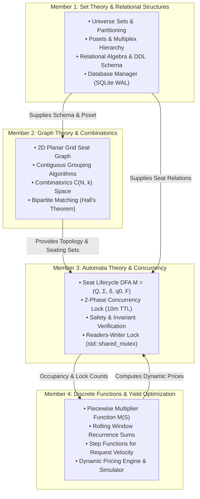
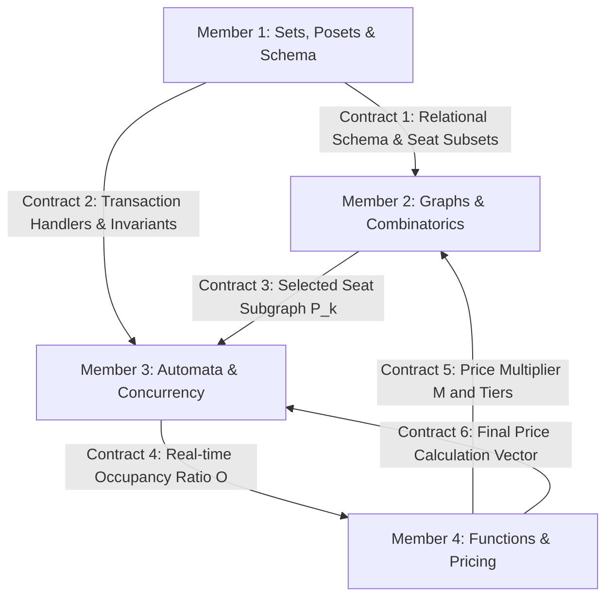
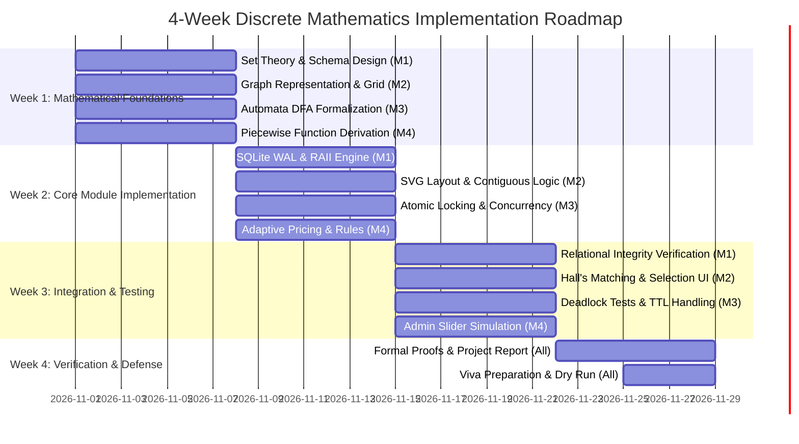

# 👥 AuraCinemas — 4-Person Discrete Mathematics Project Work Division & Team Matrix
> **Rigorous Distribution of Engineering Tasks, Module Ownership & Theoretical Formalisms for 4 Team Members**  
> **Course Evaluation:** College SY-Sem1 (Second Year, Semester 1) Computer Science & Engineering — Discrete Mathematics Course Project (DM CP)  
> **Core Methodology:** Every team member owns one fundamental pillar of Discrete Mathematics mapped directly to an operational system module.

---

## 📑 Table of Contents
1. [Executive Summary & Discrete Math Division Strategy](#1-executive-summary--discrete-math-division-strategy)
2. [High-Level Module & Mathematical Ownership Overview](#2-high-level-module--mathematical-ownership-overview)
3. [Individual Member Roles & Mathematical Deliverables](#3-individual-member-roles--mathematical-deliverables)
   - [Member 1: Relational Structures, Set Theory & Database Foundations](#member-1-relational-structures-set-theory--database-foundations)
   - [Member 2: Graph Theory, Combinatorics & Spatial Auditorium Allocation](#member-2-graph-theory-combinatorics--spatial-auditorium-allocation)
   - [Member 3: Automata Theory, Formal Languages & Concurrency State Machines](#member-3-automata-theory-formal-languages--concurrency-state-machines)
   - [Member 4: Discrete Functions, Probability & Dynamic Pricing Optimization](#member-4-discrete-functions-probability--dynamic-pricing-optimization)
4. [Cross-Member Mathematical Collaboration & Dependency Matrix](#4-cross-member-mathematical-collaboration--dependency-matrix)
5. [4-Week Implementation & Theory Roadmap](#5-4-week-implementation--theory-roadmap)
6. [Comprehensive Individual Viva Defense & Oral Examination Guide](#6-comprehensive-individual-viva-defense--oral-examination-guide)

---

## 1. Executive Summary & Discrete Math Division Strategy

In academic evaluations for **Discrete Mathematics (DM)**, software projects frequently suffer from a disconnect between high-level code and the underlying mathematical formalism. In **AuraCinemas**, each of the 4 team members is assigned primary ownership of a distinct foundational branch of Discrete Mathematics, translating abstract mathematical proofs directly into working software components.



---

## 2. High-Level Module & Mathematical Ownership Overview

| Member | Discrete Mathematics Specialization | System Architecture Module | Core Code Deliverables | Primary Viva Focus |
| :---: | :--- | :--- | :--- | :--- |
| **Member 1** | **Set Theory, Relations & Predicate Logic** | Relational Database, Entity Models & Multiplex Hierarchy | `database/schema.sql`, `dataset.sql`, `backend/src/database/db_manager.hpp` | Equivalence classes, Poset lattices, relational tuple calculus, foreign key invariants |
| **Member 2** | **Graph Theory & Combinatorics** | Spatial Seat Grid, Contiguous Allocation & Discovery | `frontend/public/js/seat-selection.js`, `frontend/public/booking.html`, `index.html` | Planar grid graphs, bipartite matching, Hall's theorem, binomial coefficients $\binom{N}{k}$, Pigeonhole bounds |
| **Member 3** | **Automata Theory & Formal Verification** | Concurrency Control, Lock Manager & State Transitions | `backend/src/services/booking_service.hpp`, `server.py` (Lock endpoints) | DFA specification, transition tables, mutual exclusion truth tables, safety proofs |
| **Member 4** | **Discrete Functions, Probability & Recurrence** | Dynamic Pricing Engine, Yield Optimization & Simulation | `backend/src/services/pricing_engine.hpp`, `server.py` (Adaptive pricing), `admin.html` | Piecewise continuous functions, asymmetric slopes, rolling decay recurrence, clamp limits |

---

## 3. Individual Member Roles & Mathematical Deliverables

---

### Member 1: Relational Structures, Set Theory & Database Foundations
> **Mathematical Domain:** *Set Theory, Binary Relations, Equivalence Relations, Partial Orders (Posets), Relational Algebra & Predicate Calculus*  
> **System Role:** *Database Architect & Domain Entity Specialist*

#### 1. Theoretical Concepts & Formal Mathematical Work:
1. **Universe Domain Formulation**:
   - Formally defines the universal entity sets: Users $\mathbf{U}$, Cities $\mathbf{C}$, Theaters $\mathbf{T}$, Screens $\mathbf{S}$, Shows $\mathbf{H}$, and Seats $\mathbf{E}$.
2. **Equivalence Partitioning of Physical Seats**:
   - Defines the equivalence relation $\sim_{\text{tier}}$ on seat set $\mathbf{E}$:
     $$e_a \sim_{\text{tier}} e_b \iff \text{Category}(e_a) = \text{Category}(e_b)$$
   - Formally proves reflexivity, symmetry, and transitivity.
   - Shows that the quotient set $\mathbf{E} / \sim_{\text{tier}}$ induces a true partition:
     $$\mathbf{E} = E_{\text{Standard}} \uplus E_{\text{Balcony}} \uplus E_{\text{Premium}} \uplus E_{\text{Recliner}} \uplus E_{\text{VIP}}$$
3. **Multiplex Structural Hierarchy as a Partially Ordered Set (Poset)**:
   - Models the spatial containment relation $\preceq$ over $X = \mathbf{C} \cup \mathbf{T} \cup \mathbf{S} \cup \mathbf{H} \cup \mathbf{E}$.
   - Demonstrates that $(X, \preceq)$ forms a rooted tree poset and semi-lattice with a unique supremum (Corporate Multiplex Root $\top$).
4. **Relational Algebra & First-Order Predicate Logic**:
   - Formulates relational queries using select ($\sigma$), project ($\pi$), and join ($\bowtie$) operators.
   - Proves functional dependencies ($X \to Y$) to guarantee Third Normal Form (3NF) and Boyce-Codd Normal Form (BCNF), eliminating data redundancy.

#### 2. Concrete Software Deliverables:
- `database/schema.sql`: 15 relational tables with primary keys, foreign keys, and index constraints.
- `database/dataset.sql`: Structured initial dataset for Indian metropolitan cities, multiplexes, and theaters.
- `backend/src/database/db_manager.hpp`: C++ RAII connection manager for SQLite WAL mode, preventing handle leaks.
- Parameterized query dispatcher ensuring immunity to SQL injection.

---

### Member 2: Graph Theory, Combinatorics & Spatial Auditorium Allocation
> **Mathematical Domain:** *Graph Theory (Planar Graphs, Adjacency, Subgraphs, Bipartite Graphs), Combinatorics (Combinations, Permutations, Pigeonhole Principle, Hall's Marriage Theorem)*  
> **System Role:** *Spatial UI Architect & Combinatorial Algorithm Specialist*

#### 1. Theoretical Concepts & Formal Mathematical Work:
1. **Auditorium Seat Layout as a Planar Grid Graph**:
   - Constructs the undirected graph $G = (V, E_{\text{grid}})$ where vertices $v_{i, j}$ represent row-column coordinates and edges represent Manhattan adjacency:
     $$(v_{i, j}, v_{k, l}) \in E_{\text{grid}} \iff |i - k| + |j - l| = 1$$
   - Visualizes seating status (available, locked, booked) as a **3-vertex coloring** problem:
     $$\chi: V \to \{\text{Available (Green)}, \text{Locked (Amber)}, \text{Booked (Dark Grey)}\}$$
2. **Combinatorial Configuration Space**:
   - Analyzes the combinatorial explosion of choosing $k$ non-ordered seats from an auditorium of capacity $N$:
     $$\binom{N}{k} = \frac{N!}{k!(N - k)!}$$
   - Demonstrates that for $N = 192, k = 4$, the user selects from a configuration space of $54,846,540$ possibilities.
3. **Contiguous Seating Subgraph Search**:
   - Formulates the problem of finding $k$ adjacent seats as finding a path subgraph $P_k = (v_{i, j}, v_{i, j+1}, \dots, v_{i, j+k-1})$ in row $i$ where every vertex satisfies $\text{Status}(v) = \text{'available'}$.
   - Computes the maximum number of contiguous blocks of length $k$ in an $R \times C$ grid:
     $$\text{Capacity}(R, C, k) = R \times \max(0, C - k + 1)$$
4. **Bipartite Matching & Hall's Marriage Theorem**:
   - Models customer reservation requests $V_{\text{req}}$ and auditorium seats $V_{\text{seat}}$ as a bipartite graph $G_B = (V_{\text{req}}, V_{\text{seat}}, E_{\text{pref}})$.
   - Proves that a complete matching exists if and only if Hall's Condition holds: $\forall W \subseteq V_{\text{req}}, |N(W)| \ge |W|$.
5. **Pigeonhole Principle in Auditorium Occupancy**:
   - Proves that if $m$ seats are booked across $K$ rows, at least one row contains $\lceil m / K \rceil$ booked seats.

#### 2. Concrete Software Deliverables:
- `frontend/public/js/seat-selection.js`: Dynamic 2D SVG vector seat layout renderer and adjacency validator.
- `frontend/public/booking.html`: Real-time interactive seat selection and dynamic breakdown panel.
- `frontend/public/index.html`: Movie catalog with multi-city and multi-language discovery filters.

---

### Member 3: Automata Theory, Formal Languages & Concurrency State Machines
> **Mathematical Domain:** *Deterministic Finite Automata (DFA), Non-Deterministic Finite Automata (NFA), Formal Verification, Temporal Logic (Safety & Liveness), Boolean Algebra*  
> **System Role:** *Concurrency, Lock Engine & Transaction State Specialist*

#### 1. Theoretical Concepts & Formal Mathematical Work:
1. **Formal DFA Specification of the Seat Lifecycle**:
   - Defines the 5-tuple automaton:
     $$M_{\text{seat}} = (Q, \Sigma, \delta, q_0, F)$$
     - $Q = \{\text{Available } (q_0), \text{Locked } (q_1), \text{Booked } (q_2), \text{Cancelled } (q_3)\}$
     - $\Sigma = \{\text{Select}(u), \text{Deselect}(u), \text{TTLExpire}, \text{ConfirmPayment}(u), \text{CancelBooking}(u), \text{ResetInventory}\}$
     - $q_0 = \text{Available}$
     - $F = \{q_2\}$ (Accepting state representing confirmed revenue)
2. **State Transition Function ($\delta$) & Truth Table**:
   - Maps each state-transition pair and verifies that the automaton is **deterministic** (for every pair $(q, \sigma)$, $|\delta(q, \sigma)| \le 1$).
3. **Safety & Liveness Proofs**:
   - **Safety Property (No Double-Booking)**:
     $$\forall t, \forall s \in \mathbf{E}, \quad \text{card}\Big(\{u \in \mathbf{U} \mid \text{ConfirmedSeat}(u, s, t)\}\Big) \le 1$$
   - Proves that atomic conditional SQL updates (`UPDATE show_seats ... WHERE status = 'available'`) guarantee this safety invariant even under arbitrary thread scheduling.
   - **Liveness Property (No Permanent Lock Stalling)**:
     $$\forall s \in \mathbf{E}, \quad \text{State}(s) = \text{Locked} \implies \lozenge (\text{State}(s) = \text{Booked} \lor \text{State}(s) = \text{Available})$$
     Proves that the 10-minute TTL guarantee forces a resolution in finite time.
4. **Boolean Algebra of Mutex Locks & Deadlock Avoidance**:
   - Constructs truth tables for readers-writer exclusion:
     $$\text{CanRead} \iff \neg \text{HasWriter}, \quad \text{CanWrite} \iff \neg \text{HasWriter} \land \neg \text{HasReaders}$$
   - Implements resource ordering on multi-seat bookings (sorting seat IDs before locking) to mathematically prevent the **Dining Philosophers / Circular Wait Deadlock**.

#### 2. Concrete Software Deliverables:
- `backend/src/services/booking_service.hpp`: High-concurrency booking service featuring `std::shared_mutex` synchronization and atomic SQLite transactions.
- Concurrency Lock Manager in `server.py`: Atomic 2-phase lock reservation (`POST /api/shows/:id/lock`) and TTL expiry logic.
- Role-Based Access Control logic enforcing strict customer vs. admin execution boundaries.

---

### Member 4: Discrete Functions, Probability & Dynamic Pricing Optimization
> **Mathematical Domain:** *Piecewise Continuous Functions, Injections/Surjections, Recurrence Relations, Discrete Time Series, Probability Distributions & Microeconomic Optimization*  
> **System Role:** *Dynamic Pricing Engine & Yield Optimization Specialist*

#### 1. Theoretical Concepts & Formal Mathematical Work:
1. **The Piecewise Dynamic Multiplier Function**:
   - Defines the piecewise pricing curve $M: [0.0, 100.0] \to [0.80, 1.80]$:
     $$M(S) = \begin{cases} 
     1.00 + \left( \frac{S - 50.0}{50.0} \right) \times 0.80 & \text{for } 50.0 \le S \le 100.0 \\
     1.00 - \left( \frac{50.0 - S}{50.0} \right) \times 0.20 & \text{for } 0.0 \le S < 50.0 
     \end{cases}$$
   - Formally proves:
     - **Continuity at Boundary**: $\lim_{S \to 50^-} M(S) = \lim_{S \to 50^+} M(S) = M(50) = 1.00$.
     - **Monotonicity**: $\forall S_1, S_2 \in [0, 100], S_1 < S_2 \implies M(S_1) \le M(S_2)$.
     - **Asymmetric Rate of Change**: $\frac{dM}{dS}\big|_{\text{surge}} = +0.016$ vs $\frac{dM}{dS}\big|_{\text{discount}} = -0.004$.
2. **Discrete Recurrence & Sliding Window Summations**:
   - Models traffic telemetry as a discrete finite sum over a sliding 30-minute window:
     $$V_{\text{loc}}(t) = 3.0 \sum_{\tau=0}^{30} H_T(t - \tau) + 1.5 \sum_{\tau=0}^{30} H_C(t - \tau) + 0.5 \sum_{\tau=0}^{30} H_M(t - \tau)$$
3. **Step Functions for Velocity Bonus (C++ Rules Engine)**:
   - Formulates the request velocity bonus $\Phi(\text{RPM})$ as a discrete step function with compact interval definitions.
4. **Billing & Taxation Function**:
   - Formulates the total billing function as a composition of linear transformations:
     $$\text{Total} = \sum_{s \in \text{Seats}} \Big( \lfloor P_{\text{base}}(s) \cdot M(S) \rceil \times 1.18 + 30.0 \Big)$$
5. **Sensitivity Analysis & Administrative Simulation**:
   - Designs mathematical perturbation tests to evaluate how dynamic prices react to shifts in occupancy and footfall.

#### 2. Concrete Software Deliverables:
- `backend/src/services/pricing_engine.hpp`: Strategy-pattern C++ pricing engine with discrete temporal, occupancy, holiday, and RPM rules.
- Real-time continuous adaptive dynamic pricing engine in `server.py` (`AdaptivePricingEngine`).
- `frontend/public/admin.html`: Multiplex administrative dashboard with live interactive traffic simulation slider ($0 \to 100$).

---

## 4. Cross-Member Mathematical Collaboration & Dependency Matrix

To ensure modular isolation without blocking progress, team members interact through well-defined mathematical contracts:



### Formal Interface Contracts:
1. **Contract 1 (Member 1 $\to$ Member 2)**: Member 1 provides the seat universe $\mathbf{E}$ partitioned by categories $E_{\text{tier}}$, which Member 2 maps into a 2D planar grid graph $G_{\text{seat}}$.
2. **Contract 2 (Member 1 $\to$ Member 3)**: Member 1 exposes atomic database primitives (`execute_update()`), which Member 3 uses to enforce the DFA state transitions.
3. **Contract 3 (Member 2 $\to$ Member 3)**: Member 2 passes user-selected seat coordinates as an ordered vector of IDs, which Member 3 processes for atomic lock acquisition.
4. **Contract 4 (Member 3 $\to$ Member 4)**: Member 3 computes real-time auditorium capacity utilization $O(t) = \frac{\text{booked} + \text{locked}}{\text{capacity}} \times 100$, which serves as input to Member 4's pricing engine.
5. **Contract 5 & 6 (Member 4 $\to$ Members 2 & 3)**: Member 4 outputs the evaluated multiplier $M(S)$ and dynamic prices, which Member 2 displays on the UI and Member 3 commits to billing records.

---

## 5. 4-Week Implementation & Theory Roadmap



---

## 6. Comprehensive Individual Viva Defense & Oral Examination Guide

---

### Member 1 Viva Defense: Sets, Relations & Database Architecture

#### Q1: "How does the multiplex geographic structure satisfy the axioms of a Partially Ordered Set (Poset)?"
> **Model Answer:**  
> "A Poset $(X, \preceq)$ requires three mathematical properties:
> 1. **Reflexivity**: For any entity $x$ (e.g., Seat A-12), $x \preceq x$ is trivially true as an entity contains itself.
> 2. **Antisymmetry**: If $x \preceq y$ and $y \preceq x$, then $x$ and $y$ must be the identical entity (a Screen cannot contain a Theater if the Theater contains the Screen).
> 3. **Transitivity**: If Seat A-12 $\preceq$ Screen 1, and Screen 1 $\preceq$ Nexus Mall Theater, then Seat A-12 $\preceq$ Nexus Mall Theater.
> Thus, the spatial multiplex hierarchy constitutes a strict tree poset with the parent company as the maximum element $\top$."

#### Q2: "Prove that your seat category classification forms a true mathematical partition."
> **Model Answer:**  
> "We define a relation $\sim_{\text{tier}}$ on seat set $\mathbf{E}$ where $e_a \sim_{\text{tier}} e_b \iff \text{Category}(e_a) = \text{Category}(e_b)$.
> This relation is an equivalence relation because equality is reflexive, symmetric, and transitive.
> By the Fundamental Theorem of Equivalence Relations, the equivalence classes partition $\mathbf{E}$ into disjoint subsets:
> $$\mathbf{E} = E_{\text{Standard}} \uplus E_{\text{Balcony}} \uplus E_{\text{Premium}} \uplus E_{\text{Recliner}} \uplus E_{\text{VIP}}$$
> where $E_i \cap E_j = \emptyset$ for $i \ne j$, and $\bigcup E_k = \mathbf{E}$. No seat can belong to two tiers simultaneously."

---

### Member 2 Viva Defense: Graph Theory, Combinatorics & Allocation

#### Q1: "How do you model contiguous seat selection using Graph Theory?"
> **Model Answer:**  
> "We model the auditorium as an undirected planar grid graph $G = (V, E_{\text{grid}})$, where each vertex is a seat coordinate $v_{i, j}$. Contiguous seat selection for $k$ seats requires discovering a simple path subgraph $P_k = (v_{i, j}, v_{i, j+1}, \dots, v_{i, j+k-1})$ along a single row $i$ such that every vertex in $P_k$ has the status 'available'. If an edge $(v_{i, c}, v_{i, c+1})$ is interrupted by a booked seat, the path is disconnected, forcing the algorithm to evaluate the next contiguous component."

#### Q2: "Explain the combinatorial space of seat reservations and how the Pigeonhole Principle applies."
> **Model Answer:**  
> "For an auditorium of $N$ seats, selecting $k$ unordered seats produces $\binom{N}{k} = \frac{N!}{k!(N-k)!}$ configurations. For $N = 192, k = 4$, this yields over 54.8 million possible combinations.
> The Pigeonhole Principle governs auditorium capacity: if an auditorium has $K$ rows and $m$ tickets are sold, by the Generalized Pigeonhole Principle, at least one row must contain at least $\lceil m / K \rceil$ occupied seats. Moreover, if total booked seats $m > N - k$, by the pigeonhole principle it is mathematically impossible to find any available block of $k$ contiguous seats."

---

### Member 3 Viva Defense: Automata Theory & Concurrency Verification

#### Q1: "Formally specify the Finite State Machine (FSM) governing a seat's lifecycle."
> **Model Answer:**  
> "The seat lifecycle is a 5-tuple Deterministic Finite Automaton $M = (Q, \Sigma, \delta, q_0, F)$:
> - $Q = \{\text{Available } (q_0), \text{Locked } (q_1), \text{Booked } (q_2), \text{Cancelled } (q_3)\}$
> - $\Sigma = \{\text{SelectAndHold}, \text{Deselect}, \text{TTLExpire}, \text{ConfirmPayment}, \text{CancelBooking}, \text{ResetInventory}\}$
> - $q_0 = \text{Available}$
> - $F = \{\text{Booked}\}$
> The transition function $\delta$ maps $(q_0, \text{SelectAndHold}) \to q_1$, and $(q_1, \text{ConfirmPayment}) \to q_2$.
> If payment is not completed within 10 minutes, the temporal event $\text{TTLExpire}$ triggers $\delta(q_1, \text{TTLExpire}) \to q_0$, returning the seat to the available pool."

#### Q2: "How do you mathematically prove that race conditions and double-booking are impossible in your system?"
> **Model Answer:**  
> "We enforce a safety invariant: $\forall t, \forall s \in \mathbf{E}, \sum_{u \in \mathbf{U}} [\text{Booked}(s, u, t)] \le 1$.
> In concurrent execution, this is guaranteed by using an atomic test-and-set conditional transition at the database engine level:
> ```sql
> UPDATE show_seats SET status = 'locked', locked_by_user_id = ? 
> WHERE show_seat_id = ? AND status = 'available';
> ```
> In SQLite's serialized execution model, this operation is atomic. If two threads execute this simultaneously, exactly one thread updates 1 row, while the second receives 0 affected rows and is rejected. Hence, mutual exclusion is maintained unconditionally."

---

### Member 4 Viva Defense: Functions, Recurrence & Dynamic Pricing

#### Q1: "Explain the mathematical formulation of your piecewise multiplier function and prove its continuity."
> **Model Answer:**  
> "The multiplier function $M(S)$ maps the score $S \in [0, 100]$ to $[0.80, 1.80]$:
> $$M(S) = \begin{cases} 
> 1.00 + \left( \frac{S - 50.0}{50.0} \right) \times 0.80 & \text{for } S \ge 50 \\ 
> 1.00 - \left( \frac{50.0 - S}{50.0} \right) \times 0.20 & \text{for } S < 50 
> \end{cases}$$
> To prove continuity at the boundary $S = 50$:
> - Left-hand limit: $\lim_{S \to 50^-} \left(1.00 - \frac{50 - S}{50} \times 0.20\right) = 1.00 - 0 = 1.00$
> - Right-hand limit: $\lim_{S \to 50^+} \left(1.00 + \frac{S - 50}{50} \times 0.80\right) = 1.00 + 0 = 1.00$
> - Value at point: $M(50) = 1.00$
> Since $\lim_{S \to 50^-} M(S) = \lim_{S \to 50^+} M(S) = M(50)$, the function is continuous across its entire domain."

#### Q2: "What is the microeconomic and mathematical justification for having asymmetric slopes in $M(S)$?"
> **Model Answer:**  
> "The surge derivative is $\frac{dM}{dS} = +0.016$ per point above 50, whereas the discount derivative is $\frac{dM}{dS} = -0.004$ per point below 50. The surge slope is exactly **4 times steeper**.
> Microeconomically, cinema theaters face high fixed costs (projector lamps, auditorium rent, electricity) and negligible marginal costs per patron. Dropping prices too steeply (e.g., -60%) severely harms unit revenue without generating sufficient additional footfall to cover fixed overheads. Therefore, the downward slope is conservative (capped at -20%), while the upward slope is agile enough to capture consumer surplus during peak demand (up to +80%)."

---
*Authored by AuraCinemas Engineering Team • College SY-Sem1 Discrete Mathematics Course Project*
